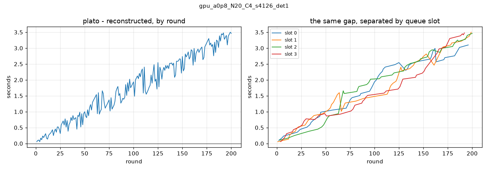

# Stage 2 — Change C: the clock, reconstructed outside PLATO

PLATO adds the host's `processing_time` — a real `perf_counter()` delta
(`plato/clients/strategies/defaults.py:252`) — into every report's finish
time, and that finish time becomes the simulated clock
(`plato/servers/base.py:1025-1030`). The clock is therefore inflated by
whatever else the machine was doing.

`clock_reconstruction.py` recomputes it from the dispatch order in the
logs and the per-client sleep times, replaying a C-slot queue. PLATO is
not modified.

---

## C3 — is the dispatch order actually recoverable?

**Yes. It is the ORDER OF LINES in the single server log, and nothing
else carries it.**

Three line shapes are read (`clock_reconstruction.read_events`):

| line | what it gives |
|---|---|
| `[Server #PID] Starting round N/M.` | the round number that labels the events after it |
| `[Server #PID] Selecting client #K for training.` | one dispatch, in sequence |
| `[Server #PID] Adding client #K to the list of clients for aggregation.` | one merge, in sequence |

**The round number cannot carry the order and must not be used for it.**
Round 1 fills every slot, so it contains C dispatches:

```
round 1   Selecting client #20
round 1   Selecting client #18
round 1   Selecting client #15
round 1   Selecting client #14
round 2   Selecting client #4
round 3   Selecting client #13
```

Round 1 dispatches 4 clients and every later round dispatches 1 (one merge frees one slot). Grouping by round would leave the first
round's clients unordered, and their start times all equal, so the error
would be invisible rather than wrong-looking.

**Where it could be ambiguous, and is not here:**

- A run directory holding more than one `server_*.log` would mean the
  directory was reused and two dispatch sequences are interleaved.
  `server_log()` refuses rather than picking one.
- A merge naming a client with no unconsumed dispatch would mean the two
  sequences disagree. `clock_per_round()` refuses rather than guessing.

- `gpu_a0p8_N20_C4_s4126_det1`: 203 dispatches, 200 merges, 200 rounds, one server log. No ambiguity.
- `gpu_a0p8_N20_C4_s4126_det2`: 203 dispatches, 200 merges, 200 rounds, one server log. No ambiguity.
- `gpu_a0p8_N20_C4_s4126_det3`: 203 dispatches, 200 merges, 200 rounds, one server log. No ambiguity.
- `gpu_a0p8_N20_C4_s4126_det4`: 203 dispatches, 200 merges, 200 rounds, one server log. No ambiguity.

The reconstruction reads `comm_time` from the config, not as a literal
zero: `[clients] comm_simulation = true` means PLATO charges 0, and a
config with it `false` is REFUSED — PLATO measures comm_time on the host
there, so there is no configured value to rebuild from. Any comm latency
baked into the sleep times by `build_fleet.py --comm-bandwidth-mbps` is
already inside `sleep_times.csv` and is deliberately not added twice.

---

## C1 — is the queue model right?

The brief asks whether `sim_time_plato - sim_time_reconstructed` is
positive, monotonically increasing and reasonably smooth.

| run | final round | plato | reconstructed | gap | gap % |
|---|---|---|---|---|---|
| `gpu_a0p8_N20_C4_s4126_det1` | 200 | 283.4974 s | 280.0329 s | +3.4644 s | +1.237 % |
| `gpu_a0p8_N20_C4_s4126_det2` | 200 | 281.2436 s | 277.7779 s | +3.4657 s | +1.248 % |

**Positive: yes, at every round of both runs, never negative.**
The gap grows from +0.0561 s to +3.4644 s.

**Monotone: NO — 76 of 199 round-to-round steps
decrease.** Reported as measured rather than smoothed. But the model is
not wrong, and the reason the global series cannot be monotone is
structural:

> `processing_time` accumulates **per slot**, not globally. A client's
> finish time carries the host overhead of every report that ran in ITS
> slot before it, and none from the other three. Consecutive *rounds*
> merge clients from *different* slots, so the round-indexed gap
> alternates between four separate accumulations that are at different
> points.

Separated by slot, the picture is the one the brief expects:

| run | slot | merges | gap first → last | steps up | steps down |
|---|---|---|---|---|---|
| `det1` | 0 | 52 | +0.099 → +3.100 s | 49 | 2 |
| `det1` | 1 | 53 | +0.056 → +3.500 s | 49 | 3 |
| `det1` | 2 | 46 | +0.107 → +3.464 s | 42 | 3 |
| `det1` | 3 | 49 | +0.057 → +3.479 s | 45 | 3 |
| `det2` | 0 | 51 | +0.110 → +3.283 s | 48 | 2 |
| `det2` | 1 | 55 | +0.086 → +3.466 s | 51 | 3 |
| `det2` | 2 | 46 | +0.055 → +3.637 s | 41 | 4 |
| `det2` | 3 | 48 | +0.154 → +3.098 s | 45 | 2 |

Within a slot the gap rises on **370 of 392** steps (94 %), with a
median step of **+0.0643 s** — which is a single
report's `processing_time`, exactly what the gap is supposed to be made
of. The per-slot slope is 0.0588–0.0796 s per report,
consistent across all four slots and both runs.

Correlation between the gap and *the number of prior reports in that
client's slot*: **0.945**.

The 22 within-slot decreases are small (median -0.0919 s, worst -0.6185 s against a 3.46 s total) and have a
known cause: where two slots free within a `processing_time` of each
other, the reconstruction may put a dispatch in a different slot than
PLATO did, because PLATO chose on the real times and the reconstruction
chooses on the clean ones. The same near-ties show up as merge-order
inversions:

- `gpu_a0p8_N20_C4_s4126_det1`: merge order ascending in
  reconstructed time — **no**, 13 inversions
- `gpu_a0p8_N20_C4_s4126_det2`: merge order ascending in
  reconstructed time — **no**, 18 inversions

**VERDICT: the queue model reproduces what the server did.** The gap is
positive everywhere, tracks the per-slot report count with r = 0.94, and
has a per-report slope equal to the measured host overhead. It is not
globally monotone, and it should not be expected to be.

---

## C2 — does it fix the contamination?

Two runs of one config, 200 rounds, sequential and alone on the box.

| | PLATO clock | reconstructed clock |
|---|---|---|
| **before Change B** (`det1` vs `det2`) | 0.8014 % | 0.8118 % |
| **after Change B** (`det3` vs `det4`) | 2.1577 % | 2.1435 % |

**Before Change B, reconstructing the clock does not reduce the spread**
(0.80 % → 0.81 %). By the brief's own reading,
that puts the cause in the second column of its table: the contamination
is **not** host overhead, it is the differing dispatch order.

Directly: the two dispatch sequences diverge at dispatch 18. Once a different client is selected the two runs are
simulating different federations, and no amount of clock arithmetic
can bring them back together — the reconstructed clock is a faithful
function of the dispatch order, so a different order is a different
clock, correctly.

**After Change B, the dispatch sequences still differ (first at dispatch 43).**

The spread itself moved from 0.80 % to 2.16 %, which is NOT a regression:
once two runs diverge, the spread is a sample of a noisy quantity —
it depends on which clients each run happened to pick afterwards.
The measurable gain from Change B is WHERE the runs diverge, not the
size of the spread once they have. See `determinism_after.txt`:
`train_loss` stayed bit-identical to round 38 (was round 3), and the
dispatch sequence to dispatch 42 (was 18). Note also that the two
pairs ran on different fleets — sigma 0.18 before, the locked 0.1492
after — so their absolute clocks are not directly comparable.

**Change B did NOT fully fix the dispatch order**, so the
reconstructed clock cannot collapse to zero either. Reported as
measured.

`determinism_after.txt` § 6 locates the remaining cause, and it
is a different one: the merge order flipped on a NEAR-TIE. At
merge 38 the two runs merged clients 10 and 20 in opposite
orders, and the three clients involved (#7, #10, #20) finish
within **0.592 s** of each other in reconstructed time. Run B
merged them in ascending order; run A did not.

PLATO pops the smallest `(finish_time, client_id)` off a heap,
and `finish_time` carries the accumulated `processing_time` —
~0.065 s per report, accumulating per slot, so two slots differ
by several tenths of a second by round 39 (C1 above). A 0.592 s
gap between two clients' simulated finishes is inside that. So
**which client the server merges first is being decided by the
machine rather than by the experiment**, and from that point the
two runs hand different models to different clients.

This is the residual Stage 1 predicted and could not see, because
the worker-assignment race dominated it. Change B removed that
larger cause and exposed this one.

**It cannot be fixed from the example folder.** The reordering
happens inside PLATO's heap, on a value PLATO computes; the only
fix is to keep `processing_time` out of `finish_time`, which is
an edit to `plato/servers/base.py` and out of scope here. What
Change C does give is a TIME AXIS that is immune to it — the
reconstructed clock never contains `processing_time`, whatever
order the merges came in.

---



Left: the round-indexed gap, which alternates between four slot
accumulations. Right: the same data separated by slot, where each
line is the near-monotone accumulation the model predicts.

