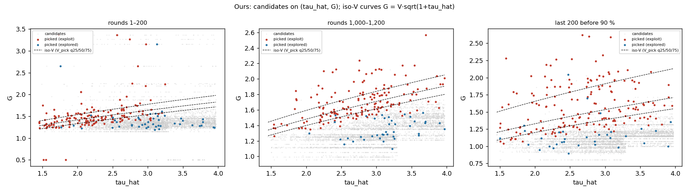
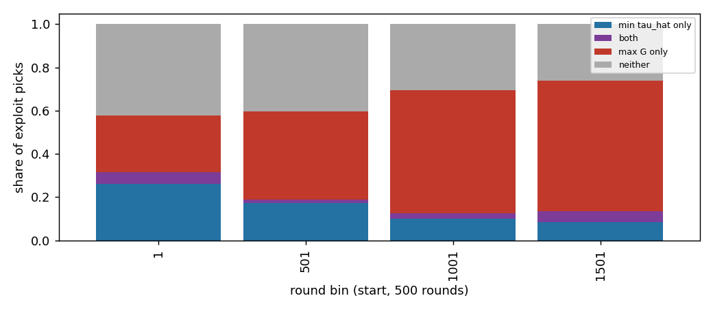
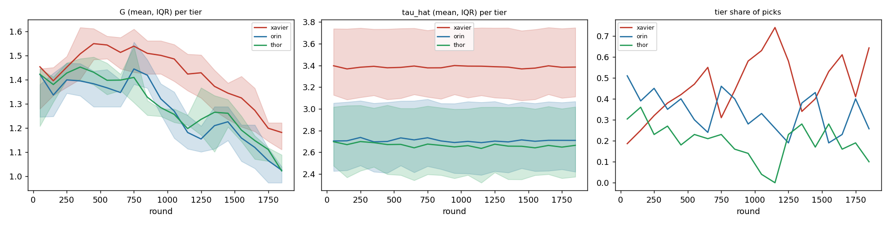
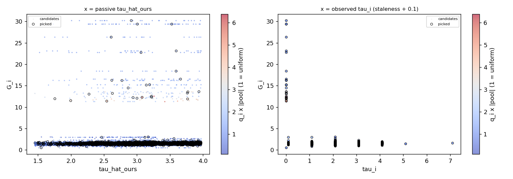
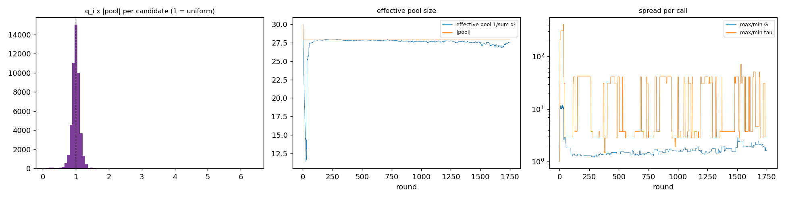
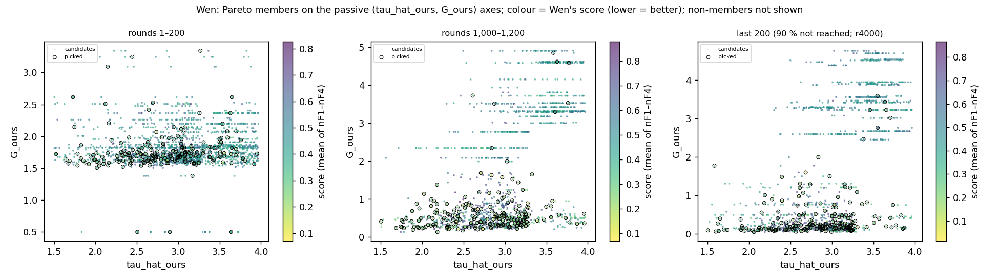
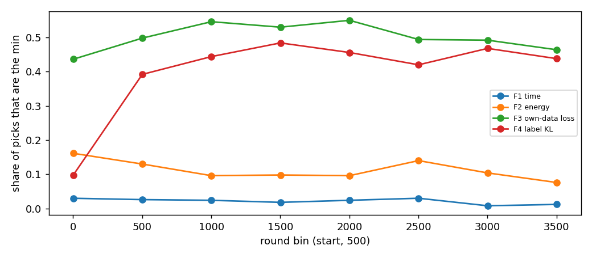
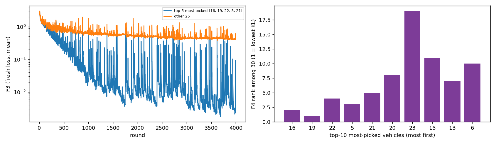
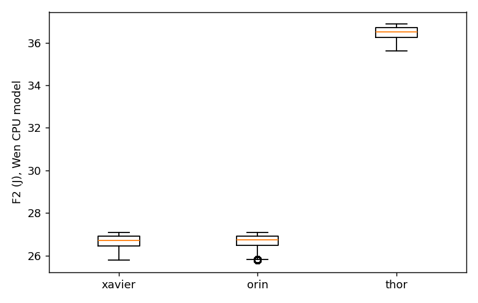
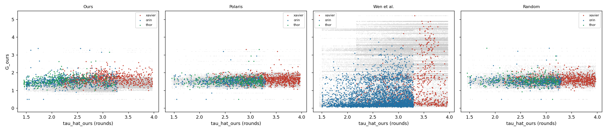

# Mechanism report — mechanism_s1_s4126 (Prompt M A4; mechanical)

Axes: `tau_hat_ours` (rounds) and `G_ours` are the passive values of Ours' scorer (gpu T̂_train + T̂_up through the queue kernel; G from the update norm, alpha = 1), logged for every arm. Static counterfactuals re-decide logged decisions and do not feed back.

## Ours (`gpu`) — `S1_gpu_s4126_pm`

**1. Candidate map** 

**2. Exploit picks: the min-tau_hat candidate, the max-G candidate, both, neither** 

| bin start | min tau_hat only | both | max G only | neither |
|---|---|---|---|---|
| 1 | 0.26 | 0.05 | 0.26 | 0.42 |
| 501 | 0.17 | 0.02 | 0.41 | 0.40 |
| 1001 | 0.10 | 0.03 | 0.57 | 0.31 |
| 1501 | 0.09 | 0.05 | 0.61 | 0.26 |

Whole run: max G only 0.45, neither 0.35, min tau_hat only 0.16, both 0.04 (exploit picks 1,481; explored 391).

**3. Static counterfactual on the logged exploit decisions** (explored decisions keep their pick in every rule)

| rule | pick-change share (exploit decisions) | dispatch Gini |
|---|---|---|
| actual | — | 0.097 |
| tau_hat only | 0.806 | 0.424 |
| G only | 0.523 | 0.296 |
| V (exploit) | 0.000 | 0.097 |

**4. Per-tier G and tau_hat over time, tier share** 

**5. Per vehicle: dispatch count vs mean G and mean tau_hat (over its candidate rows)**

| vs | Spearman rho | p |
|---|---|---|
| mean G | -0.162 | 0.39 |
| mean tau_hat | -0.293 | 0.12 |

## Polaris — `S1_polaris_s4126_pm`

**6. Candidate maps, colour = q_i relative to uniform** 

**7. q vs uniform, effective pool, spread** 

q_i x |pool|: median 1.000, 5–95 % 0.805–1.190; max q per call median 0.0436; effective pool / |pool| median 0.990.

**8. Per vehicle: dispatch count vs mean G, tau, tau_hat_ours**

| vs | Spearman rho | p |
|---|---|---|
| mean G_i | 0.076 | 0.69 |
| mean tau_i | -0.027 | 0.89 |
| mean tau_hat_ours | -0.234 | 0.21 |

## Wen et al. (`wen_fresh`) — `S1_wen_fresh_s4126_pm`

**9. Candidate map** 

**10. Share of picks that are the minimum of each objective** 

Whole run: F1 time 0.02, F2 energy 0.11, F3 own-data loss 0.50, F4 label KL 0.40.

**11. F3 feedback loop and F4 rank** 

| model version at | round | F3 top-5 | F3 other 25 | ratio |
|---|---|---|---|---|
| 0 % | 1 | 2.3032 | 2.3023 | 1.0 |
| 10 % | 400 | 0.3045 | 0.7852 | 2.6 |
| 50 % | 2000 | 0.0146 | 0.5481 | 37.6 |
| 100 % | 4000 | 0.0049 | 0.4174 | 85.3 |

Top-10 most picked [16, 19, 22, 5, 21, 20, 23, 15, 13, 6]: dispatches [981, 828, 747, 641, 502, 103, 31, 26, 22, 19] of 4002; F4 ranks [2, 1, 4, 3, 5, 8, 19, 11, 7, 10].

**12. F2 by tier and the constraint cuts** 

| tier | candidate rows | cut by T only | cut by E only | cut by both | total cut | share of picks |
|---|---|---|---|---|---|---|
| xavier | 58,162 | 0.123 | 0.000 | 0.000 | 0.123 | 0.198 |
| orin | 33,887 | 0.134 | 0.000 | 0.000 | 0.134 | 0.802 |
| thor | 20,010 | 0.000 | 0.597 | 0.000 | 0.597 | 0.000 |

Fallback decisions: 0.

**13. Static counterfactual (same feasible set, re-decided per logged decision)**

| rule | pick-change share | dispatch Gini |
|---|---|---|
| logged picks | — | 0.818 |
| actual rule (F1–F4) | 0.000 | 0.818 |
| drop F1 | 0.136 | 0.827 |
| drop F2 | 0.136 | 0.835 |
| drop F3 | 0.310 | 0.737 |
| drop F4 | 0.459 | 0.627 |
| F1 + F2 only | 0.889 | 0.293 |
| F3 + F4 only | 0.436 | 0.885 |

## Cross-arm (14) 

Grey = every candidate the arm saw; dots = its picks, by tier. Axes are the passive values Ours' scorer would compute, so position on them means the same in every panel.

| arm | tau_hat_ours picked | tau_hat_ours all candidates | G_ours picked | G_ours all candidates | T_hat_train picked (s) | T_hat_up picked (s) | true T_train (s) | true T_up (s) | mean |x_finish − 1000| (m) |
|---|---|---|---|---|---|---|---|---|---|
| Ours | 2.613 | 3.038 | 1.585 | 1.355 | 1.438 | 7.931 | 1.384 | 8.342 | 279 |
| Polaris | 3.010 | 3.019 | 1.575 | 1.557 | 1.527 | 9.265 | 1.457 | 9.863 | 489 |
| Wen et al. | 2.768 | 3.040 | 0.738 | 2.330 | 0.837 | 9.085 | 0.790 | 9.595 | 460 |
| Random | 2.990 | 3.018 | 1.573 | 1.580 | 1.461 | 9.260 | 1.385 | 9.876 | 492 |
