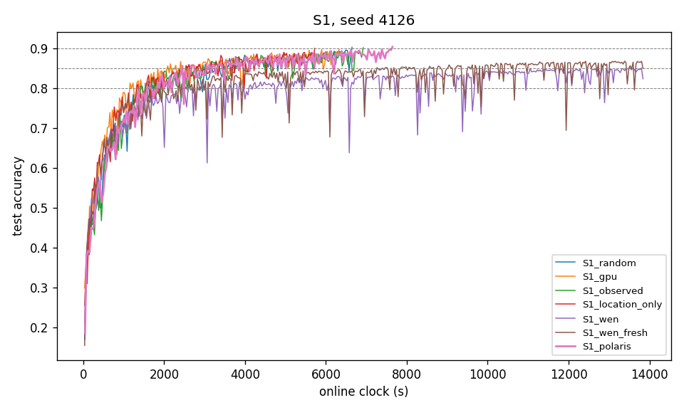

# Polaris in S1, seed 4126 — Prompt J report

**Status (21 Oct 2026).** `S1_polaris_s4126` reached 90% at round 2,020, online clock 7,646 s.
- Manifest: predictions v3.5 `0f459b68`, source commit `0b24a268`, source-tree sha256 `0dd5a110…`, seed 4126.
- Clock replay: online = replayed on the 100-round check runs and on the smoke run (max diff 0.0 s, no order residuals).
- Seeds 4127 and 4128 were launched after this report, on the user's go-ahead of 21 Oct, which overrides the prompt's "seed 4126 done → stop".

**Deviations.**
- **D6, τ convention.** Prompt J (PL4) uses τ = staleness + 0.1 with initial τ = 0.01. The paper defines τ ≥ 1 with τ = 1 for a fresh update (§3).
  - This was reported as a contradiction before the run.
  - The user chose +0.1 on 21 Oct.
  - Measured effect on q over 84 replayed S1 states: TV ≤ 3e-5.
- **G_i baseline (ADR-0020 D7).** G_i is the update against the global model the client was **sent**, as in the prompt's definition and the paper's Eq. 5. It is computed in the existing tracker through an optional `start_weights` table. Plato's code measures against the current global instead.
- **`polaris_plato` was not implemented** (Step 2.3, optional). It needs cvxopt, which is in neither project venv.
- **The paper was not on the pod** (`Polaris.pdf`). The authors' copy was read: `iqua.ece.toronto.edu/papers/ykang-tcc24.pdf`.
- **`source_dirty: true` in the manifest.** It comes from an uncommitted edit to `wen_env/study2_report.py` (Study 2 reporting, 21 Oct 11:10), which is not on the run path. The source-tree hash records the exact tree that ran.
- **Reading B** (`wen_faithful_v1_step6_footnote.md`). S1 gpu at seed 4126 counts as reaching 90% at its maximum, 0.8975 at 6,326 s, as in every table since Prompt F.
- **Comparator runs** are resolved through `wen_ptable.run_dir`. For seed 4126 this means `_phaseA/` for random, gpu and observed.

## 1. S1 table, seed 4126

| arm | TTA@80% (s) | TTA@85% (s) | TTA@90% (s) | s/round whole / <80% / ≥80% | energy to 80% (kJ) | share X / O / T r1–500 | share X / O / T last 500 | mean \|x_upload − 1000\| (m) | Gini | distinct | image coverage r500 / r1000 / end |
|---|---|---|---|---|---|---|---|---|---|---|---|
| random | 1419 | 2568 | 6645 | 3.754 / 3.734 / 3.760 | 23.6 | 0.43 / 0.39 / 0.18 | 0.48 / 0.35 / 0.18 | 492 | 0.084 | 30 | 1.000 / 1.000 / 1.000 |
| gpu | 1158 | 2089 | 6326 | 3.244 / 2.969 / 3.313 | 19.4 | 0.32 / 0.38 / 0.30 | 0.52 / 0.31 / 0.18 | 283 | 0.114 | 30 | 1.000 / 1.000 / 1.000 |
| observed | 1426 | 2962 | 6920 | 3.681 / 3.656 / 3.688 | 23.1 | 0.42 / 0.32 / 0.25 | 0.49 / 0.30 / 0.20 | 465 | 0.113 | 30 | 1.000 / 1.000 / 1.000 |
| location_only | 1326 | 2547 | 5723 | 3.347 / 3.235 / 3.382 | 29.6 | 0.55 / 0.29 / 0.16 | 0.55 / 0.27 / 0.18 | 279 | 0.133 | 30 | 1.000 / 1.000 / 1.000 |
| wen | 2625 | 11049 | — | 3.460 / 3.454 / 3.462 | 33.0 | 0.20 / 0.80 / 0.00 | 0.18 / 0.82 / 0.00 | 465 | 0.834 | 30 | 0.833 / 0.900 / 1.000 |
| wen_fresh | 1967 | 7263 | — | 3.460 / 3.513 / 3.451 | 28.6 | 0.31 / 0.67 / 0.02 | 0.18 / 0.82 / 0.00 | 456 | 0.819 | 24 | 0.733 / 0.767 / 0.800 |
| polaris | 1580 | 2452 | 7646 | 3.785 / 3.761 / 3.792 | 27.8 | 0.47 / 0.34 / 0.18 | 0.55 / 0.32 / 0.14 | 496 | 0.050 | 30 | 1.000 / 1.000 / 1.000 |

## 2. Polaris internals over time (seed 4126)

| rounds | calls | median max q | median effective pool 1/Σq² | G range | τ range |
|---|---|---|---|---|---|
| 1–500 | 500 | 0.0411 | 27.86 | 0.500–29.895 | 0.01–6.10 |
| 501–1000 | 500 | 0.0433 | 27.77 | 1.064–2.169 | 0.10–4.10 |
| 1001–1500 | 500 | 0.0452 | 27.61 | 0.911–2.146 | 0.10–5.10 |
| 1501–2000 | 500 | 0.0490 | 27.40 | 0.852–2.300 | 0.10–5.10 |
| 2001–2500 | 20 | 0.0488 | 27.43 | 0.998–2.100 | 0.10–4.10 |

Spearman correlation of per-vehicle dispatch count (30 vehicles) with:

| quantity | ρ | p |
|---|---|---|
| mean G | -0.170 | 0.369 |
| mean τ | 0.171 | 0.366 |
| tier (X=0, O=1, T=2) | -0.109 | 0.567 |
| mean V = G/√(1+τ) | -0.283 | 0.13 |

## 3. P34–P37

| P | comparison | seed (gpu vs polaris) | direction | status |
|---|---|---|---|---|
| P34 | gpu has lower s/round than polaris | 3.244 vs 3.785 | as predicted | single seed — not evaluated |
| P35 | gpu has lower TTA@80% than polaris | 1158 vs 1580 | as predicted | single seed — not evaluated |
| P36 | gpu uses less ground-truth energy to reach 80% than polaris | 19.4 kJ vs 27.8 kJ | as predicted | single seed — not evaluated |
| P37 | polaris has a lower whole-run dispatch Gini than gpu | 0.114 vs 0.050 | as predicted | single seed — not evaluated |

## 4. Curves

## 5. Step 0 answers and code-vs-paper differences

**Step 0.1 (Plato code).**
- **Staleness term:** the code uses **τ²**: `staleness = np.square(local_stalenesses)` (`polaris_selection_strategy.py:169`), multiplied in at `:178`. The paper's P4 (Eq. 23) is linear in τ_i, and the host follows the paper (PL4b).
- **Unseen clients:** after each aggregation they get G = α × the mean norm of that aggregation (`polaris_aggregation_strategy.py:107–111`). This matches the prompt.

**Step 0.2.** `FedAsyncPolarisAggregationStrategy` runs through PLATO's `aggregate_weights` path, as a subclass of `SequentialFedAsyncAggregationStrategy`. It writes per-client G to `context.state["polaris"]["local_gradient_bounds"]`, which the new selector reads. It measured the update against the current global (D7 above), so an optional `start_weights` table was added; when it is `None`, earlier arms are unchanged.

**Step 0.3.**
- No Study 2 run was in progress.
- `ckpt_cleaner.py` (pid 108910) covers every run under `runs/wen_env/` by base path.
- `run_cells.sh` applied the disk guard before launch: 142 GB free.
- The Study 2 watchdog's ClockMismatch check also matches the `S1_polaris_s4126` log.

**Code-vs-paper differences** (full table in ADR-0020):
- D1: the GP constraints are applied to the log-variables.
- D2: τ² instead of τ.
- D3: batch-relative p_i.
- D4: the global NumPy RNG is used while `random`'s state is saved.
- D5: MOSEK is never used.
- D6: τ offset 0.1 instead of τ ≥ 1.
- D7: the update baseline is the current global.
- D8: FedBuff aggregation in the code; FedAsync here (PL2).

**Recorded, not tuned** (ADR-0020, "Observation"): with p_i ≈ 1/30 and A = 1, μ ≫ f2, so q_i ≈ G_i / ΣG. Section 2 shows the effective pool at 27.4–27.9 of about 27–28 candidates throughout the run.
