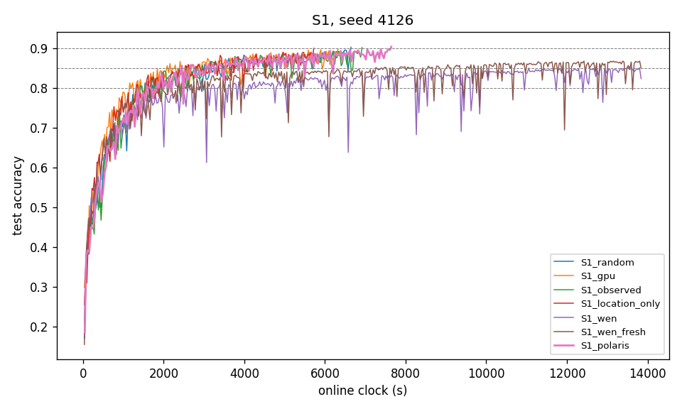

## 1. S1 table, seed 4126

| arm | TTA@80% (s) | TTA@85% (s) | TTA@90% (s) | s/round whole / <80% / ≥80% | energy to 80% (kJ) | share X / O / T r1–500 | share X / O / T last 500 | mean \|x_upload − 1000\| (m) | Gini | distinct | image coverage r500 / r1000 / end |
|---|---|---|---|---|---|---|---|---|---|---|---|
| random | 1419 | 2568 | 6645 | 3.754 / 3.734 / 3.760 | 23.6 | 0.43 / 0.39 / 0.18 | 0.48 / 0.35 / 0.18 | 492 | 0.084 | 30 | 1.000 / 1.000 / 1.000 |
| gpu | 1158 | 2089 | 6326 | 3.244 / 2.969 / 3.313 | 19.4 | 0.32 / 0.38 / 0.30 | 0.52 / 0.31 / 0.18 | 283 | 0.114 | 30 | 1.000 / 1.000 / 1.000 |
| observed | 1426 | 2962 | 6920 | 3.681 / 3.656 / 3.688 | 23.1 | 0.42 / 0.32 / 0.25 | 0.49 / 0.30 / 0.20 | 465 | 0.113 | 30 | 1.000 / 1.000 / 1.000 |
| location_only | 1326 | 2547 | 5723 | 3.347 / 3.235 / 3.382 | 29.6 | 0.55 / 0.29 / 0.16 | 0.55 / 0.27 / 0.18 | 279 | 0.133 | 30 | 1.000 / 1.000 / 1.000 |
| wen | 2625 | 11049 | — | 3.460 / 3.454 / 3.462 | 33.0 | 0.20 / 0.80 / 0.00 | 0.18 / 0.82 / 0.00 | 465 | 0.834 | 30 | 0.833 / 0.900 / 1.000 |
| wen_fresh | 1967 | 7263 | — | 3.460 / 3.513 / 3.451 | 28.6 | 0.31 / 0.67 / 0.02 | 0.18 / 0.82 / 0.00 | 456 | 0.819 | 24 | 0.733 / 0.767 / 0.800 |
| polaris | 1580 | 2452 | 7646 | 3.785 / 3.761 / 3.792 | 27.8 | 0.47 / 0.34 / 0.18 | 0.55 / 0.32 / 0.14 | 496 | 0.050 | 30 | 1.000 / 1.000 / 1.000 |

## 2. Polaris internals over time (seed 4126)

| rounds | calls | median max q | median effective pool 1/Σq² | G range | τ range |
|---|---|---|---|---|---|
| 1–500 | 500 | 0.0411 | 27.86 | 0.500–29.895 | 0.01–6.10 |
| 501–1000 | 500 | 0.0433 | 27.77 | 1.064–2.169 | 0.10–4.10 |
| 1001–1500 | 500 | 0.0452 | 27.61 | 0.911–2.146 | 0.10–5.10 |
| 1501–2000 | 500 | 0.0490 | 27.40 | 0.852–2.300 | 0.10–5.10 |
| 2001–2500 | 20 | 0.0488 | 27.43 | 0.998–2.100 | 0.10–4.10 |

Spearman correlation of per-vehicle dispatch count (30 vehicles) with:

| quantity | ρ | p |
|---|---|---|
| mean G | -0.170 | 0.369 |
| mean τ | 0.171 | 0.366 |
| tier (X=0, O=1, T=2) | -0.109 | 0.567 |
| mean V = G/√(1+τ) | -0.283 | 0.13 |

## 3. P34–P37

| P | comparison | seed (gpu vs polaris) | direction | status |
|---|---|---|---|---|
| P34 | gpu has lower s/round than polaris | 3.244 vs 3.785 | as predicted | single seed — not evaluated |
| P35 | gpu has lower TTA@80% than polaris | 1158 vs 1580 | as predicted | single seed — not evaluated |
| P36 | gpu uses less ground-truth energy to reach 80% than polaris | 19.4 kJ vs 27.8 kJ | as predicted | single seed — not evaluated |
| P37 | polaris has a lower whole-run dispatch Gini than gpu | 0.114 vs 0.050 | as predicted | single seed — not evaluated |

## 4. Curves

