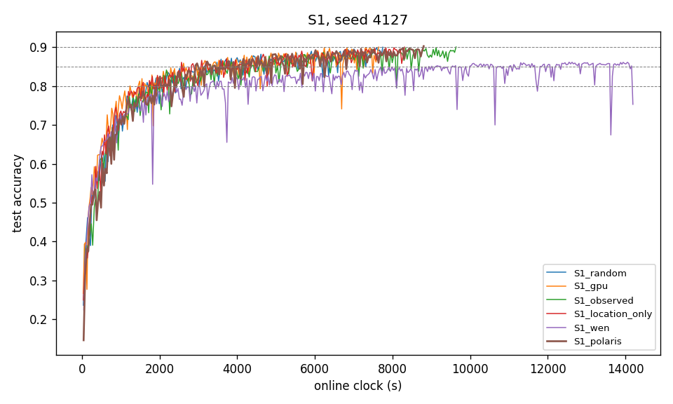

## 1. S1 table, seed 4127

| arm | TTA@80% (s) | TTA@85% (s) | TTA@90% (s) | s/round whole / <80% / ≥80% | energy to 80% (kJ) | share X / O / T r1–500 | share X / O / T last 500 | mean \|x_upload − 1000\| (m) | Gini | distinct | image coverage r500 / r1000 / end |
|---|---|---|---|---|---|---|---|---|---|---|---|
| random | 1678 | 3177 | 7749 | 3.798 / 3.728 / 3.818 | 30.1 | 0.49 / 0.35 / 0.16 | 0.53 / 0.33 / 0.14 | 497 | 0.073 | 30 | 1.000 / 1.000 / 1.000 |
| gpu | 1237 | 2616 | 7644 | 3.253 / 3.017 / 3.303 | 21.2 | 0.32 / 0.43 / 0.25 | 0.53 / 0.31 / 0.16 | 284 | 0.132 | 30 | 1.000 / 1.000 / 1.000 |
| observed | 1748 | 3364 | 9638 | 3.707 / 3.641 / 3.722 | 31.9 | 0.51 / 0.31 / 0.17 | 0.49 / 0.30 / 0.21 | 462 | 0.090 | 30 | 1.000 / 1.000 / 1.000 |
| location_only | 1546 | 2563 | 8310 | 3.364 / 3.220 / 3.399 | 35.0 | 0.57 / 0.29 / 0.14 | 0.54 / 0.30 / 0.16 | 298 | 0.109 | 30 | 1.000 / 1.000 / 1.000 |
| wen | 2925 | 8938 | — | 3.549 / 3.482 / 3.566 | 29.7 | 0.16 / 0.84 / 0.00 | 0.13 / 0.87 / 0.00 | 526 | 0.817 | 26 | 0.833 / 0.867 / 0.867 |
| wen_fresh | not run at seed 4127 | | | | | | | | | | |
| polaris | 1903 | 2924 | 8803 | 3.762 / 3.732 / 3.771 | 32.9 | 0.47 / 0.34 / 0.20 | 0.51 / 0.34 / 0.15 | 493 | 0.049 | 30 | 1.000 / 1.000 / 1.000 |

## 2. Polaris internals over time (seed 4127)

| rounds | calls | median max q | median effective pool 1/Σq² | G range | τ range |
|---|---|---|---|---|---|
| 1–500 | 500 | 0.0432 | 27.81 | 0.500–29.977 | 0.01–4.10 |
| 501–1000 | 500 | 0.0455 | 27.65 | 1.065–2.106 | 0.10–5.10 |
| 1001–1500 | 500 | 0.0474 | 27.38 | 0.870–2.232 | 0.10–5.10 |
| 1501–2000 | 500 | 0.0473 | 27.34 | 0.797–2.219 | 0.10–4.10 |
| 2001–2500 | 340 | 0.0491 | 26.94 | 0.672–2.324 | 0.10–5.10 |

Spearman correlation of per-vehicle dispatch count (30 vehicles) with:

| quantity | ρ | p |
|---|---|---|
| mean G | 0.075 | 0.695 |
| mean τ | -0.099 | 0.603 |
| tier (X=0, O=1, T=2) | 0.079 | 0.676 |
| mean V = G/√(1+τ) | 0.000 | 0.999 |

## 3. P34–P37

| P | comparison | seed (gpu vs polaris) | direction | status |
|---|---|---|---|---|
| P34 | gpu has lower s/round than polaris | 3.253 vs 3.762 | as predicted | single seed — not evaluated |
| P35 | gpu has lower TTA@80% than polaris | 1237 vs 1903 | as predicted | single seed — not evaluated |
| P36 | gpu uses less ground-truth energy to reach 80% than polaris | 21.2 kJ vs 32.9 kJ | as predicted | single seed — not evaluated |
| P37 | polaris has a lower whole-run dispatch Gini than gpu | 0.132 vs 0.049 | as predicted | single seed — not evaluated |

## 4. Curves

