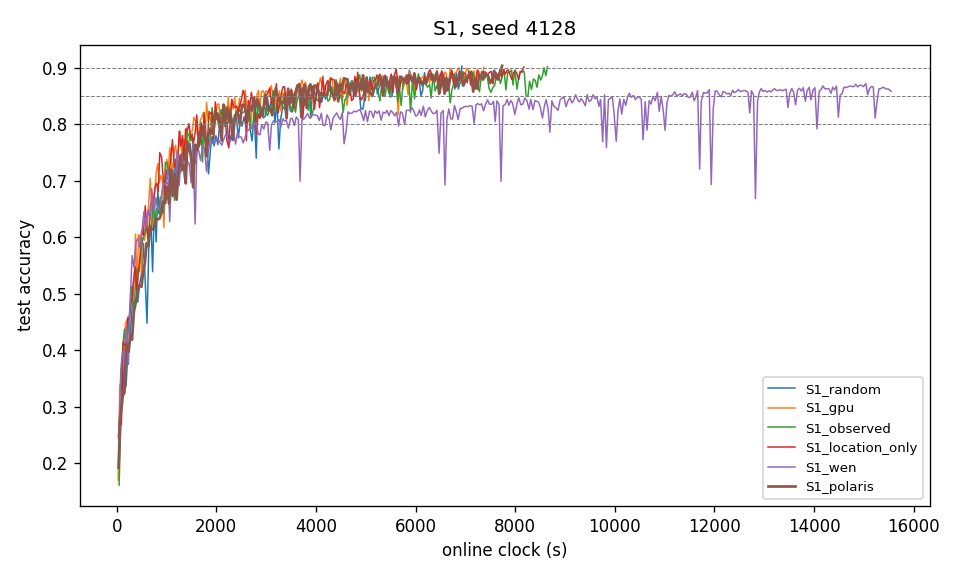

## 1. S1 table, seed 4128

| arm | TTA@80% (s) | TTA@85% (s) | TTA@90% (s) | s/round whole / <80% / ≥80% | energy to 80% (kJ) | share X / O / T r1–500 | share X / O / T last 500 | mean \|x_upload − 1000\| (m) | Gini | distinct | image coverage r500 / r1000 / end |
|---|---|---|---|---|---|---|---|---|---|---|---|
| random | 2102 | 3559 | 6931 | 3.767 / 3.754 / 3.772 | 36.9 | 0.47 / 0.35 / 0.17 | 0.50 / 0.34 / 0.16 | 496 | 0.051 | 30 | 1.000 / 1.000 / 1.000 |
| gpu | 1550 | 2581 | 7373 | 3.234 / 2.980 / 3.309 | 25.9 | 0.27 / 0.48 / 0.25 | 0.54 / 0.29 / 0.17 | 282 | 0.128 | 30 | 1.000 / 1.000 / 1.000 |
| observed | 1693 | 3143 | 8650 | 3.681 / 3.603 / 3.701 | 28.1 | 0.42 / 0.39 / 0.19 | 0.49 / 0.32 / 0.19 | 464 | 0.130 | 30 | 1.000 / 1.000 / 1.000 |
| location_only | 1452 | 2539 | 8176 | 3.337 / 3.226 / 3.362 | 33.0 | 0.56 / 0.30 / 0.14 | 0.52 / 0.34 / 0.14 | 295 | 0.094 | 30 | 1.000 / 1.000 / 1.000 |
| wen | 2767 | 9214 | — | 3.887 / 3.898 / 3.885 | 52.0 | 0.62 / 0.37 / 0.01 | 0.49 / 0.51 / 0.00 | 549 | 0.796 | 29 | 0.700 / 0.800 / 0.967 |
| wen_fresh | not run at seed 4128 | | | | | | | | | | |
| polaris | 1988 | 2976 | 7739 | 3.757 / 3.752 / 3.758 | 36.1 | 0.51 / 0.32 / 0.17 | 0.51 / 0.33 / 0.16 | 488 | 0.053 | 30 | 1.000 / 1.000 / 1.000 |

## 2. Polaris internals over time (seed 4128)

| rounds | calls | median max q | median effective pool 1/Σq² | G range | τ range |
|---|---|---|---|---|---|
| 1–500 | 500 | 0.0418 | 27.84 | 0.500–29.508 | 0.01–4.10 |
| 501–1000 | 500 | 0.0422 | 27.80 | 1.023–1.907 | 0.10–5.10 |
| 1001–1500 | 500 | 0.0454 | 27.56 | 0.952–2.106 | 0.10–5.10 |
| 1501–2000 | 500 | 0.0463 | 27.21 | 0.782–2.189 | 0.10–5.10 |
| 2001–2500 | 60 | 0.0463 | 27.19 | 0.946–2.081 | 0.10–4.10 |

Spearman correlation of per-vehicle dispatch count (30 vehicles) with:

| quantity | ρ | p |
|---|---|---|
| mean G | -0.054 | 0.776 |
| mean τ | 0.166 | 0.38 |
| tier (X=0, O=1, T=2) | -0.201 | 0.286 |
| mean V = G/√(1+τ) | -0.248 | 0.186 |

## 3. P34–P37

| P | comparison | seed (gpu vs polaris) | direction | status |
|---|---|---|---|---|
| P34 | gpu has lower s/round than polaris | 3.234 vs 3.757 | as predicted | single seed — not evaluated |
| P35 | gpu has lower TTA@80% than polaris | 1550 vs 1988 | as predicted | single seed — not evaluated |
| P36 | gpu uses less ground-truth energy to reach 80% than polaris | 25.9 kJ vs 36.1 kJ | as predicted | single seed — not evaluated |
| P37 | polaris has a lower whole-run dispatch Gini than gpu | 0.128 vs 0.053 | as predicted | single seed — not evaluated |

## 4. Curves

