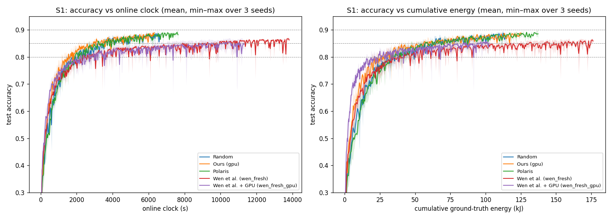

# Scenario 1 — final report (Prompt K)

**Status (23 Oct 2026).** S1 is complete: every method in the thesis tables has seeds 4126, 4127 and 4128.
- The four Prompt K runs (`wen_fresh` and `wen_fresh_gpu` at seeds 4127 / 4128) ran in parallel from 22 Oct 18:03 to 23 Oct 18:28 UTC.
- All four ran the full 4,000 rounds without reaching 90%.
- Online = replayed clock in all four: 4,002 dispatches, 4,000 merges, max diff 0.0 s, no order residuals.

**Step 0 (pre-flight).**
1. **Code.** The run path changed after the seed-4126 runs (Prompt J commit `0b24a268`). The 200-round replays on the current code reproduce the seed-4126 runs row for row: `S1_wen_fresh_s4126_replay200k` and `S1_wen_fresh_gpu_s4126_replay200k` give 202 identical dispatch-log rows and 202 identical `wen_decisions.csv` rows each, with online = replayed clock. The new runs ran at source commit `0dd3fa3e`.
2. **Configs.** The new configs differ from seed 4126 only in seed, base path, port, and the header comment that names seed and path.
3. **Limits** match the seed-4126 manifests:
   - `wen_fresh`: T_max = 34.334345905647005 s, E_max = 36.423846640394224 J;
   - `wen_fresh_gpu`: T_max = 13.564085609369194 s, E_max = 113.50862433236982 J.
4. **Prediction hashes** in the manifests: v3.3 `77e2d7b7` in all four; v3.4 `0174b23d` in the `wen_fresh_gpu` runs.
5. **Disk and processes.** 138.5 GB was free at launch, the checkpoint cleaner was running, and no Study 2 or Polaris run was active.
6. **Watchdog.** `wen_env/tools/watchdog.sh` (report-only) alerts after 30 minutes without a merge and stops all runs on a clock mismatch. The old Study 2 watchdog was stopped.

**Deviations.**
- **Watchdog alerts:** none; there were no reruns.
- **`source_dirty: true`** in the new manifests comes from the uncommitted `wen_env/study2_report.py` (Study 2 reporting), which is not on the run path.
- **Reading B** (`wen_faithful_v1_step6_footnote.md`): S1 gpu at seed 4126 counts as reaching 90% at its maximum, 0.8975, as in every table since Prompt F.

## 2.1 Main S1 table (mean ± sd over seeds; per-seed rows in 2.1c)

### 2.1a Time, energy and rounds to accuracy

| method | seeds | TTA@80% (s) | TTA@85% (s) | TTA@90% (s) | energy to 80% (kJ) | energy to 85% (kJ) | energy to 90% (kJ) | rounds to 80% | rounds to 85% | rounds to 90% | s/round whole / <80% / ≥80% | max accuracy |
|---|---|---|---|---|---|---|---|---|---|---|---|---|
| Random | 3 | 1,733 ± 345 | 3,102 ± 500 | 7,108 ± 573 | 30.2 ± 6.7 | 54.4 ± 9.8 | 125.8 ± 12.8 | 463 ± 91 | 820 ± 131 | 1,883 ± 140 | 3.773 ± 0.023 / 3.739 ± 0.014 / 3.784 ± 0.031 | 0.9019 ± 0.0014 |
| Ours (gpu) | 3 | 1,315 ± 207 | 2,429 ± 295 | 7,114 ± 696 | 22.2 ± 3.3 | 45.0 ± 5.6 | 140.1 ± 13.0 | 440 ± 70 | 790 ± 95 | 2,193 ± 214 | 3.244 ± 0.009 / 2.989 ± 0.025 / 3.308 ± 0.005 | 0.8996 ± 0.0018 |
| Polaris | 3 | 1,824 ± 216 | 2,784 ± 289 | 8,063 ± 643 | 32.3 ± 4.2 | 49.7 ± 5.8 | 145.3 ± 11.0 | 487 ± 59 | 740 ± 78 | 2,140 ± 174 | 3.768 ± 0.015 / 3.748 ± 0.015 / 3.773 ± 0.017 | 0.9035 ± 0.0007 |
| Wen et al. (wen_fresh) | 3 | 2,046 ± 255 | 7,738 ± 1,205 | not reached (0/3; max 0.8713 ± 0.0033) | 31.8 ± 9.3 | 114.4 ± 41.7 | not reached (0/3; max 0.8713 ± 0.0033) | 560 ± 50 | 2,133 ± 242 | not reached (0/3; max 0.8713 ± 0.0033) | 3.646 ± 0.190 / 3.647 ± 0.158 / 3.645 ± 0.195 | 0.8713 ± 0.0033 |
| Wen et al. + GPU (wen_fresh_gpu) | 3 | 2,061 ± 797 | not reached (2/3; max 0.8599 ± 0.0156) | not reached (0/3; max 0.8599 ± 0.0156) | 18.5 ± 5.6 | not reached (2/3; max 0.8599 ± 0.0156) | not reached (0/3; max 0.8599 ± 0.0156) | 693 ± 240 | not reached (2/3; max 0.8599 ± 0.0156) | not reached (0/3; max 0.8599 ± 0.0156) | 2.934 ± 0.112 / 2.947 ± 0.118 / 2.931 ± 0.109 | 0.8599 ± 0.0156 |
| Wen stale (wen), reference | 3 | 2,772 ± 150 | 9,734 ± 1,147 | not reached (0/3; max 0.8616 ± 0.0103) | 38.2 ± 12.1 | 132.4 ± 39.3 | not reached (0/3; max 0.8616 ± 0.0103) | 770 ± 66 | 2,703 ± 438 | not reached (0/3; max 0.8616 ± 0.0103) | 3.632 ± 0.225 / 3.611 ± 0.249 / 3.638 ± 0.221 | 0.8616 ± 0.0103 |

### 2.1b Selection behaviour

| method | seeds | share X / O / T r1–500 | share X / O / T last 500 | Gini | distinct vehicles | image coverage r500 / r1000 / end | mean \|x_upload − 1000\| (m) | mean \|x̂ − x\| (m) |
|---|---|---|---|---|---|---|---|---|
| Random | 3 | 0.46 / 0.36 / 0.17 | 0.50 / 0.34 / 0.16 | 0.069 ± 0.017 | 30.0 ± 0.0 | 1.000 / 1.000 / 1.000 | 495 ± 3 | — |
| Ours (gpu) | 3 | 0.30 / 0.43 / 0.26 | 0.53 / 0.30 / 0.17 | 0.125 ± 0.009 | 30.0 ± 0.0 | 1.000 / 1.000 / 1.000 | 283 ± 1 | 5 ± 0 |
| Polaris | 3 | 0.48 / 0.34 / 0.18 | 0.52 / 0.33 / 0.15 | 0.051 ± 0.002 | 30.0 ± 0.0 | 1.000 / 1.000 / 1.000 | 492 ± 4 | — |
| Wen et al. (wen_fresh) | 3 | 0.37 / 0.63 / 0.01 | 0.31 / 0.69 / 0.00 | 0.802 ± 0.014 | 24.0 ± 0.0 | 0.689 / 0.733 / 0.800 | 503 ± 41 | 571 ± 50 |
| Wen et al. + GPU (wen_fresh_gpu) | 3 | 0.00 / 0.54 / 0.46 | 0.00 / 0.43 / 0.57 | 0.794 ± 0.056 | 12.3 ± 1.5 | 0.411 / 0.411 / 0.411 | 287 ± 55 | 1 ± 0 |
| Wen stale (wen), reference | 3 | 0.33 / 0.67 / 0.00 | 0.27 / 0.73 / 0.00 | 0.816 ± 0.019 | 28.3 ± 2.1 | 0.789 / 0.856 / 0.944 | 513 ± 43 | 574 ± 51 |

### 2.1c Per seed

| method | seed | TTA@80 / 85 / 90% (s) | energy to 80 / 85 / 90% (kJ) | rounds to 80 / 85 / 90% | s/round | max accuracy | Gini | Thor share | mean \|x_upload − 1000\| (m) | mean \|x̂ − x\| (m) |
|---|---|---|---|---|---|---|---|---|---|---|
| Random | 4126 | 1,419 / 2,568 / 6,645 | 23.6 / 43.6 / 114.7 | 380 / 680 / 1,770 | 3.754 | 0.9029 | 0.084 | 0.174 | 492 | — |
| Random | 4127 | 1,678 / 3,177 / 7,749 | 30.1 / 57.0 / 139.8 | 450 / 840 / 2,040 | 3.798 | 0.9003 | 0.073 | 0.158 | 497 | — |
| Random | 4128 | 2,102 / 3,559 / 6,931 | 36.9 / 62.7 / 122.9 | 560 / 940 / 1,840 | 3.767 | 0.9025 | 0.051 | 0.166 | 496 | — |
| Ours (gpu) | 4126 | 1,158 / 2,089 / 6,326 | 19.4 / 38.6 / 125.7 | 390 / 680 / 1,950 | 3.244 | 0.8975 | 0.114 | 0.209 | 283 | 5 |
| Ours (gpu) | 4127 | 1,237 / 2,616 / 7,644 | 21.2 / 49.2 / 151.0 | 410 / 840 / 2,350 | 3.253 | 0.9007 | 0.132 | 0.195 | 284 | 5 |
| Ours (gpu) | 4128 | 1,550 / 2,581 / 7,373 | 25.9 / 47.2 / 143.6 | 520 / 850 / 2,280 | 3.234 | 0.9006 | 0.128 | 0.191 | 282 | 5 |
| Polaris | 4126 | 1,580 / 2,452 / 7,646 | 27.8 / 43.1 / 137.4 | 420 / 650 / 2,020 | 3.785 | 0.9043 | 0.050 | 0.172 | 496 | — |
| Polaris | 4127 | 1,903 / 2,924 / 8,803 | 32.9 / 51.9 / 157.8 | 510 / 780 / 2,340 | 3.762 | 0.9031 | 0.049 | 0.170 | 493 | — |
| Polaris | 4128 | 1,988 / 2,976 / 7,739 | 36.1 / 54.1 / 140.8 | 530 / 790 / 2,060 | 3.757 | 0.9032 | 0.053 | 0.162 | 488 | — |
| Wen et al. (wen_fresh) | 4126 | 1,967 / 7,263 / not reached (max 0.8683) | 28.6 / 94.7 / not reached (max 0.8683) | 560 / 2,100 / not reached (max 0.8683) | 3.460 | 0.8683 | 0.819 | 0.002 | 456 | 514 |
| Wen et al. (wen_fresh) | 4127 | 1,839 / 6,844 / not reached (max 0.8748) | 24.6 / 86.2 / not reached (max 0.8748) | 510 / 1,910 / not reached (max 0.8748) | 3.638 | 0.8748 | 0.796 | 0.000 | 519 | 596 |
| Wen et al. (wen_fresh) | 4128 | 2,331 / 9,109 / not reached (max 0.8707) | 42.3 / 162.3 / not reached (max 0.8707) | 610 / 2,390 / not reached (max 0.8707) | 3.839 | 0.8707 | 0.792 | 0.000 | 533 | 603 |
| Wen et al. + GPU (wen_fresh_gpu) | 4126 | 1,675 / 5,046 / not reached (max 0.8661) | 16.0 / 47.9 / not reached (max 0.8661) | 570 / 1,710 / not reached (max 0.8661) | 2.917 | 0.8661 | 0.787 | 0.436 | 272 | 1 |
| Wen et al. + GPU (wen_fresh_gpu) | 4127 | 1,530 / 4,529 / not reached (max 0.8715) | 14.7 / 42.4 / not reached (max 0.8715) | 540 / 1,580 / not reached (max 0.8715) | 2.832 | 0.8715 | 0.742 | 0.515 | 241 | 1 |
| Wen et al. + GPU (wen_fresh_gpu) | 4128 | 2,977 / not reached (max 0.8422) / not reached (max 0.8422) | 24.9 / not reached (max 0.8422) / not reached (max 0.8422) | 970 / not reached (max 0.8422) / not reached (max 0.8422) | 3.053 | 0.8422 | 0.854 | 0.696 | 347 | 1 |
| Wen stale (wen), reference | 4126 | 2,625 / 11,049 / not reached (max 0.8513) | 33.0 / 138.4 / not reached (max 0.8513) | 760 / 3,200 / not reached (max 0.8513) | 3.460 | 0.8513 | 0.834 | 0.001 | 465 | 515 |
| Wen stale (wen), reference | 4127 | 2,925 / 8,938 / not reached (max 0.8617) | 29.7 / 90.5 / not reached (max 0.8617) | 840 / 2,540 / not reached (max 0.8617) | 3.549 | 0.8617 | 0.817 | 0.000 | 526 | 607 |
| Wen stale (wen), reference | 4128 | 2,767 / 9,214 / not reached (max 0.8719) | 52.0 / 168.4 / not reached (max 0.8719) | 710 / 2,370 / not reached (max 0.8719) | 3.887 | 0.8719 | 0.796 | 0.002 | 549 | 599 |

## 2.2 Verdicts (v3 rule: the same direction in all 3 seeds)

| P | prediction | seed 4126 | seed 4127 | seed 4128 | seeds as predicted | verdict (v3 rule) |
|---|---|---|---|---|---|---|
| P22 | wen_fresh Gini < wen (S1 part) | 0.819 vs 0.834 (as predicted) | 0.796 vs 0.817 (as predicted) | 0.792 vs 0.796 (as predicted) | 3/3 | held |
| P23 | wen_fresh Gini > random (S1 part) | 0.819 vs 0.084 (as predicted) | 0.796 vs 0.073 (as predicted) | 0.792 vs 0.051 (as predicted) | 3/3 | held |
| P24 | gpu TTA@80% < wen_fresh | 1,158 vs 1,967 (as predicted) | 1,237 vs 1,839 (as predicted) | 1,550 vs 2,331 (as predicted) | 3/3 | held |
| P29 | wen_fresh_gpu mean \|x̂ − x\| < wen_fresh | 1 vs 514 (as predicted) | 1 vs 596 (as predicted) | 1 vs 603 (as predicted) | 3/3 | held |
| P30 | wen_fresh_gpu mean \|x_upload − 1000\| < wen_fresh | 272 vs 456 (as predicted) | 241 vs 519 (as predicted) | 347 vs 533 (as predicted) | 3/3 | held |
| P31 | wen_fresh_gpu s/round < wen_fresh | 2.917 vs 3.460 (as predicted) | 2.832 vs 3.638 (as predicted) | 3.053 vs 3.839 (as predicted) | 3/3 | held |
| P32 | wen_fresh_gpu Thor share (whole run) > wen_fresh | 0.436 vs 0.002 (as predicted) | 0.515 vs 0.000 (as predicted) | 0.696 vs 0.000 (as predicted) | 3/3 | held |

## 2.3 Pairwise directions, Ours vs each method (reported, not predictions)

`<` = Ours lower (faster or less energy); a threshold Ours reaches and the other does not counts as Ours lower; `both n/r` = neither reached it.

| Ours vs | metric | 80%: seeds 4126 / 4127 / 4128 (Ours lower) | 85%: seeds 4126 / 4127 / 4128 (Ours lower) | 90%: seeds 4126 / 4127 / 4128 (Ours lower) |
|---|---|---|---|---|
| Random | TTA | < / < / < (3/3) | < / < / < (3/3) | < / < / > (2/3) |
| Random | energy | < / < / < (3/3) | < / < / < (3/3) | > / > / > (0/3) |
| Polaris | TTA | < / < / < (3/3) | < / < / < (3/3) | < / < / < (3/3) |
| Polaris | energy | < / < / < (3/3) | < / < / < (3/3) | < / < / > (2/3) |
| Wen et al. (wen_fresh) | TTA | < / < / < (3/3) | < / < / < (3/3) | < / < / < (3/3) |
| Wen et al. (wen_fresh) | energy | < / < / < (3/3) | < / < / < (3/3) | < / < / < (3/3) |
| Wen et al. + GPU (wen_fresh_gpu) | TTA | < / < / < (3/3) | < / < / < (3/3) | < / < / < (3/3) |
| Wen et al. + GPU (wen_fresh_gpu) | energy | > / > / > (0/3) | < / > / < (2/3) | < / < / < (3/3) |
| Wen stale (wen), reference | TTA | < / < / < (3/3) | < / < / < (3/3) | < / < / < (3/3) |
| Wen stale (wen), reference | energy | < / < / < (3/3) | < / < / < (3/3) | < / < / < (3/3) |

## 2.4 Curves



## 2.5 Run health (Prompt K runs)

| run | wall time (h) | rounds | reached 90% | fresh-evaluation time (h) | evaluations |
|---|---|---|---|---|---|
| S1_wen_fresh_s4127 | 24.37 | 4000 | no | 16.97 | 4000 |
| S1_wen_fresh_gpu_s4127 | 24.37 | 4000 | no | 16.96 | 4000 |
| S1_wen_fresh_s4128 | 24.37 | 4000 | no | 16.99 | 4000 |
| S1_wen_fresh_gpu_s4128 | 24.36 | 4000 | no | 16.94 | 4000 |

Watchdog alerts (`wen_env/logs/watchdog_alerts.log`):

```
none
```
