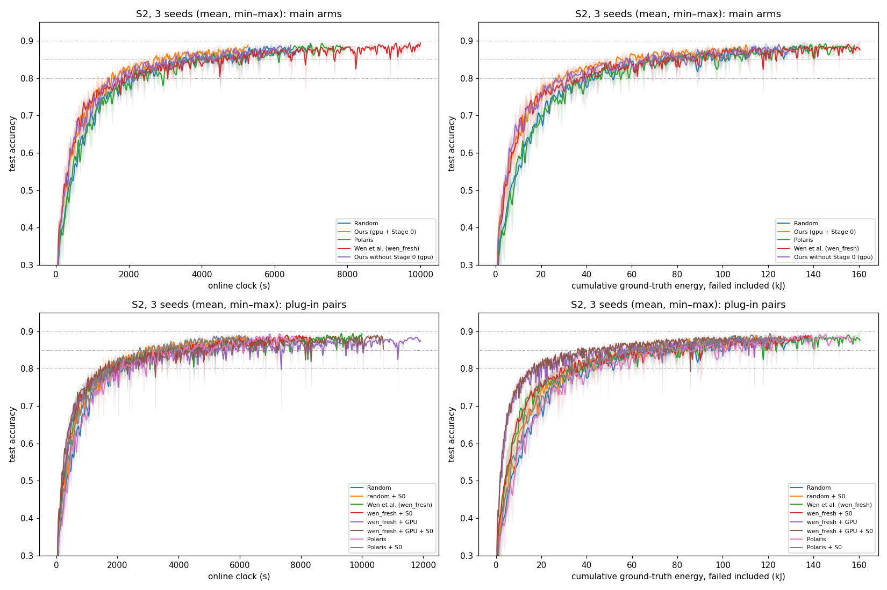

# Scenario 2 — final report, 3 seeds (Prompt L, extended on the user's go-ahead of 23 Oct)

**Status (26 Oct 2026).** S2 is complete: every S2-B arm has seeds 4126, 4127 and 4128.
- The 14 runs added after `s2_s4126.md` (7 arms × seeds 4127 / 4128) ran from 23 Oct 22:24 to 26 Oct 00:32 UTC.
- Online = replayed clock in all 14 (max diff 0.0 s, no order residuals). There were no watchdog alerts and no reruns.
- **Reached 90%:** polaris, polaris_s0, random_s0 and wen_fresh at both seeds, and wen_fresh_s0 at seed 4128.
- **Ran the full 4,000 rounds without reaching 90%:** wen_fresh_s0 at seed 4127, and wen_fresh_gpu and wen_fresh_gpu_s0 at both seeds.

**Pre-flight (as Prompt K Step 0).**
- The 200-round replays on the current code reproduce the seed-4126 runs row for row:
  - `S2_wen_fresh`: 205 dispatch rows and `wen_decisions.csv`;
  - `S2_random_s0`: 204 dispatch rows and `stage0_log.csv`;
  - `S2_wen_fresh_gpu_s0`: 203 dispatch rows and both side logs.
  These cover the fresh F3, Stage 0 and GPU F1/F2 code paths. The Polaris arms ran the code of their seed-4126 runs.
- The 14 configs differ from seed 4126 only in seed, base path and port.
- The coverage check at the end of this file is over all 30 runs.

**Definitions.** As in `s2_s4126.md`:
- energy to X% includes failed dispatches;
- STR = merged / dispatched;
- uplink airtime charges a lost upload its full T_up;
- staleness = merge round − dispatch round of merged updates.

**Deviations.**
- **Ours (gpu + Stage 0) and gpu.** These are the Prompt C main runs (seeds 4126 in `_phaseA/`, 4127 / 4128 in `runs/wen_env/`). They predate per-reason Stage 0 logging, so their Stage 0 rate is reconstructed from the server log.
- **`source_dirty: true`** in the new manifests comes from the uncommitted `wen_env/study2_report.py`, which is not on the run path.

## 1. Main S2 table (mean ± sd over 3 seeds)

| arm | TTA@80% (s) | TTA@85% (s) | TTA@90% (s) | energy to 80% (kJ) | energy to 85% (kJ) | energy to 90% (kJ) | **STR** | failed kJ (whole run) | uplink airtime to 80% (s) | rounds to 80 / 85 / 90% | max accuracy | mean staleness | s/round |
|---|---|---|---|---|---|---|---|---|---|---|---|---|---|
| Random | 1,817 ± 140 | 3,116 ± 113 | 7,685 ± 627 | 35.3 ± 2.9 | 61.0 ± 2.8 | 150.9 ± 11.9 | **0.773 ± 0.005** | 36.8 ± 4.5 | 4,679 ± 360 | 417 ± 31 / 713 ± 40 / 1,743 ± 122 | 0.9030 ± 0.0012 | 1.47 ± 0.02 | 4.406 ± 0.053 |
| Ours (gpu + Stage 0) | 1,319 ± 184 | 2,397 ± 355 | 6,638 ± 1,218 | 23.8 ± 3.1 | 46.9 ± 6.8 | 138.6 ± 24.0 | **0.991 ± 0.001** | 1.3 ± 0.5 | 3,483 ± 491 | 453 ± 64 / 810 ± 115 / 2,160 ± 392 | 0.9010 ± 0.0009 | 1.97 ± 0.00 | 3.073 ± 0.015 |
| Polaris | 1,924 ± 142 | 3,162 ± 391 | 8,101 ± 141 | 37.1 ± 3.7 | 61.1 ± 8.1 | 159.9 ± 1.6 | **0.770 ± 0.007** | 39.6 ± 2.0 | 4,963 ± 352 | 443 ± 45 / 723 ± 99 / 1,830 ± 10 | 0.9017 ± 0.0004 | 1.47 ± 0.02 | 4.426 ± 0.057 |
| Wen et al. (wen_fresh) | 1,583 ± 392 | 3,126 ± 368 | 11,680 ± 1,939 | 29.3 ± 8.4 | 56.2 ± 8.6 | 198.9 ± 35.9 | **0.958 ± 0.009** | 7.6 ± 2.6 | 4,101 ± 981 | 447 ± 101 / 887 ± 85 / 3,333 ± 525 | 0.9017 ± 0.0012 | 1.90 ± 0.02 | 3.501 ± 0.093 |
| random + S0 | 1,564 ± 208 | 2,566 ± 334 | 6,785 ± 543 | 31.0 ± 4.6 | 51.4 ± 7.6 | 134.9 ± 13.1 | **0.986 ± 0.002** | 2.3 ± 0.1 | 4,015 ± 516 | 470 ± 61 / 773 ± 107 / 2,047 ± 165 | 0.9040 ± 0.0040 | 1.96 ± 0.01 | 3.315 ± 0.005 |
| wen_fresh + S0 | 1,350 ± 179 | 2,953 ± 343 | not reached (2/3) | 24.8 ± 4.9 | 53.1 ± 7.4 | not reached (2/3) | **0.998 ± 0.001** | 0.3 ± 0.1 | 3,504 ± 423 | 397 ± 51 / 873 ± 97 / not reached (2/3) | 0.8996 ± 0.0015 | 2.00 ± 0.00 | 3.351 ± 0.043 |
| wen_fresh + GPU | 1,537 ± 206 | 3,533 ± 546 | not reached (0/3) | 15.1 ± 1.7 | 34.5 ± 4.0 | not reached (0/3) | **0.889 ± 0.023** | 13.9 ± 2.8 | 4,446 ± 604 | 477 ± 59 / 1,100 ± 132 / not reached (0/3) | 0.8860 ± 0.0015 | 1.73 ± 0.06 | 3.108 ± 0.141 |
| wen_fresh + GPU + S0 | 1,367 ± 99 | 2,828 ± 159 | not reached (0/3) | 14.0 ± 0.9 | 28.9 ± 1.6 | not reached (0/3) | **0.989 ± 0.003** | 1.2 ± 0.3 | 3,939 ± 296 | 503 ± 38 / 1,040 ± 62 / not reached (0/3) | 0.8934 ± 0.0027 | 1.97 ± 0.01 | 2.717 ± 0.034 |
| Polaris + S0 | 1,530 ± 267 | 2,517 ± 390 | 6,679 ± 618 | 30.4 ± 5.1 | 50.6 ± 8.5 | 133.6 ± 9.9 | **0.987 ± 0.002** | 2.0 ± 0.3 | 3,926 ± 694 | 460 ± 79 / 760 ± 121 / 1,997 ± 161 | 0.9009 ± 0.0008 | 1.96 ± 0.00 | 3.343 ± 0.042 |
| Ours without Stage 0 (gpu) | 1,416 ± 187 | 2,484 ± 471 | 6,869 ± 394 | 24.9 ± 2.1 | 48.2 ± 8.9 | 140.8 ± 8.8 | **0.877 ± 0.004** | 19.7 ± 0.6 | 3,762 ± 533 | 430 ± 46 / 737 ± 115 / 1,930 ± 125 | 0.9008 ± 0.0011 | 1.70 ± 0.02 | 3.560 ± 0.030 |

## 2. Selection behaviour (means over 3 seeds)

| arm | share X / O / T r1–500 | share X / O / T last 500 | Gini | distinct | image coverage r500 / r1000 / end | mean \|x_upload − 1000\| (m) | Stage 0 rejected (of eligible) |
|---|---|---|---|---|---|---|---|
| Random | 0.48 / 0.34 / 0.18 | 0.50 / 0.33 / 0.17 | 0.056 ± 0.001 | 30.0 ± 0.0 | 1.000 / 1.000 / 1.000 | 301 ± 5 | — |
| Ours (gpu + Stage 0) | 0.32 / 0.39 / 0.28 | 0.48 / 0.33 / 0.18 | 0.118 ± 0.005 | 30.0 ± 0.0 | 1.000 / 1.000 / 1.000 | 180 ± 3 | 0.240 ± 0.001 |
| Polaris | 0.47 / 0.34 / 0.19 | 0.52 / 0.33 / 0.16 | 0.054 ± 0.009 | 30.0 ± 0.0 | 1.000 / 1.000 / 1.000 | 301 ± 4 | — |
| Wen et al. (wen_fresh) | 0.46 / 0.50 / 0.05 | 0.36 / 0.60 / 0.04 | 0.639 ± 0.021 | 27.3 ± 1.5 | 0.833 / 0.856 / 0.911 | 321 ± 10 | — |
| random + S0 | 0.46 / 0.35 / 0.19 | 0.47 / 0.36 / 0.17 | 0.073 ± 0.010 | 30.0 ± 0.0 | 1.000 / 1.000 / 1.000 | 250 ± 3 | 0.241 ± 0.001 |
| wen_fresh + S0 | 0.45 / 0.51 / 0.05 | 0.38 / 0.57 / 0.05 | 0.615 ± 0.019 | 27.7 ± 0.6 | 0.822 / 0.867 / 0.922 | 310 ± 8 | 0.254 ± 0.001 |
| wen_fresh + GPU | 0.00 / 0.58 / 0.42 | 0.00 / 0.53 / 0.47 | 0.717 ± 0.047 | 15.0 ± 1.0 | 0.467 / 0.467 / 0.500 | 206 ± 23 | — |
| wen_fresh + GPU + S0 | 0.00 / 0.60 / 0.40 | 0.00 / 0.57 / 0.42 | 0.663 ± 0.035 | 23.7 ± 1.5 | 0.544 / 0.589 / 0.789 | 177 ± 13 | 0.243 ± 0.000 |
| Polaris + S0 | 0.47 / 0.34 / 0.19 | 0.49 / 0.34 / 0.17 | 0.064 ± 0.011 | 30.0 ± 0.0 | 1.000 / 1.000 / 1.000 | 246 ± 2 | 0.242 ± 0.003 |
| Ours without Stage 0 (gpu) | 0.32 / 0.41 / 0.28 | 0.52 / 0.32 / 0.16 | 0.134 ± 0.014 | 30.0 ± 0.0 | 1.000 / 1.000 / 1.000 | 213 ± 2 | — |

## 3. Per seed

| arm | seed | TTA@80 / 85 / 90% (s) | energy to 80 / 85 / 90% (kJ) | STR | failed kJ | max accuracy | Gini |
|---|---|---|---|---|---|---|---|
| Random | 4126 | 1,813 / 3,002 / 7,833 | 34.6 / 57.9 / 151.5 | 0.769 | 37.5 | 0.9040 | 0.057 |
| Random | 4127 | 1,959 / 3,118 / 8,226 | 38.5 / 62.0 / 162.4 | 0.772 | 40.9 | 0.9017 | 0.055 |
| Random | 4128 | 1,678 / 3,228 / 6,997 | 32.9 / 63.2 / 138.7 | 0.779 | 32.0 | 0.9034 | 0.057 |
| Ours (gpu + Stage 0) | 4126 | 1,109 / 2,003 / 5,279 | 20.3 / 39.7 / 112.1 | 0.992 | 0.9 | 0.9011 | 0.116 |
| Ours (gpu + Stage 0) | 4127 | 1,448 / 2,694 / 7,631 | 26.0 / 53.3 / 158.7 | 0.989 | 1.9 | 0.9000 | 0.124 |
| Ours (gpu + Stage 0) | 4128 | 1,402 / 2,494 / 7,005 | 25.1 / 47.6 / 145.0 | 0.991 | 1.1 | 0.9018 | 0.114 |
| Polaris | 4126 | 1,800 / 2,711 / 8,191 | 34.5 / 51.8 / 161.6 | 0.769 | 40.2 | 0.9022 | 0.050 |
| Polaris | 4127 | 1,894 / 3,399 / 8,173 | 35.6 / 64.8 / 159.9 | 0.763 | 41.2 | 0.9015 | 0.047 |
| Polaris | 4128 | 2,079 / 3,376 / 7,938 | 41.3 / 66.7 / 158.3 | 0.778 | 37.3 | 0.9015 | 0.064 |
| Wen et al. (wen_fresh) | 4126 | 1,145 / 3,108 / 10,004 | 19.8 / 52.1 / 160.9 | 0.964 | 5.7 | 0.9009 | 0.662 |
| Wen et al. (wen_fresh) | 4127 | 1,900 / 2,768 / 13,803 | 35.6 / 50.5 / 232.2 | 0.962 | 6.6 | 0.9011 | 0.622 |
| Wen et al. (wen_fresh) | 4128 | 1,702 / 3,503 / 11,231 | 32.7 / 66.1 / 203.5 | 0.948 | 10.5 | 0.9031 | 0.632 |
| random + S0 | 4126 | 1,324 / 2,260 / 6,242 | 25.7 / 44.5 / 121.6 | 0.986 | 2.2 | 0.9030 | 0.079 |
| random + S0 | 4127 | 1,693 / 2,922 / 7,328 | 34.0 / 59.6 / 147.7 | 0.987 | 2.2 | 0.9084 | 0.061 |
| random + S0 | 4128 | 1,674 / 2,515 / 6,786 | 33.4 / 50.0 / 135.3 | 0.984 | 2.4 | 0.9006 | 0.079 |
| wen_fresh + S0 | 4126 | 1,149 / 2,642 / 8,387 | 19.1 / 44.9 / 138.9 | 0.998 | 0.5 | 0.9000 | 0.637 |
| wen_fresh + S0 | 4127 | 1,491 / 3,321 / — | 28.0 / 59.2 / — | 0.999 | 0.2 | 0.8979 | 0.602 |
| wen_fresh + S0 | 4128 | 1,411 / 2,898 / 9,229 | 27.2 / 55.1 / 170.4 | 0.999 | 0.2 | 0.9008 | 0.606 |
| wen_fresh + GPU | 4126 | 1,327 / 3,205 / — | 13.1 / 31.7 / — | 0.899 | 13.0 | 0.8876 | 0.725 |
| wen_fresh + GPU | 4127 | 1,545 / 3,230 / — | 15.8 / 32.7 / — | 0.906 | 11.7 | 0.8857 | 0.667 |
| wen_fresh + GPU | 4128 | 1,739 / 4,163 / — | 16.3 / 39.1 / — | 0.863 | 17.1 | 0.8846 | 0.759 |
| wen_fresh + GPU + S0 | 4126 | 1,256 / 2,644 / — | 13.0 / 27.3 / — | 0.988 | 1.4 | 0.8950 | 0.680 |
| wen_fresh + GPU + S0 | 4127 | 1,395 / 2,926 / — | 14.7 / 30.6 / — | 0.993 | 0.8 | 0.8903 | 0.622 |
| wen_fresh + GPU + S0 | 4128 | 1,448 / 2,913 / — | 14.3 / 28.8 / — | 0.987 | 1.4 | 0.8950 | 0.686 |
| Polaris + S0 | 4126 | 1,225 / 2,066 / 6,381 | 24.5 / 40.9 / 128.8 | 0.986 | 2.1 | 0.9017 | 0.073 |
| Polaris + S0 | 4127 | 1,722 / 2,734 / 7,389 | 33.4 / 54.7 / 144.9 | 0.989 | 1.7 | 0.9001 | 0.067 |
| Polaris + S0 | 4128 | 1,644 / 2,750 / 6,266 | 33.3 / 56.3 / 127.0 | 0.985 | 2.2 | 0.9009 | 0.052 |
| Ours without Stage 0 (gpu) | 4126 | 1,348 / 2,254 / 6,931 | 24.7 / 45.4 / 143.7 | 0.877 | 20.1 | 0.9021 | 0.122 |
| Ours without Stage 0 (gpu) | 4127 | 1,273 / 2,171 / 7,229 | 22.9 / 41.1 / 147.7 | 0.882 | 20.0 | 0.9002 | 0.130 |
| Ours without Stage 0 (gpu) | 4128 | 1,628 / 3,025 / 6,448 | 27.0 / 58.2 / 130.9 | 0.873 | 19.1 | 0.9001 | 0.149 |

## 4. Verdicts (v3 rule: the same direction in all 3 seeds; waste lower = STR higher, v3.6)

| P | prediction | seed 4126 | seed 4127 | seed 4128 | seeds as predicted | verdict (v3 rule) |
|---|---|---|---|---|---|---|
| P25 | gpu (Stage 0 off) has lower TTA@80% than wen_fresh | 1,348 vs 1,145 (not) | 1,273 vs 1,900 (as predicted) | 1,628 vs 1,702 (as predicted) | 2/3 | not held |
| P26 | random + Stage 0 has a lower waste fraction than random (STR higher) | 0.986 vs 0.769 (as predicted) | 0.987 vs 0.772 (as predicted) | 0.984 vs 0.779 (as predicted) | 3/3 | held |
| P27 | random + Stage 0 has a lower TTA@80% than random | 1,324 vs 1,813 (as predicted) | 1,693 vs 1,959 (as predicted) | 1,674 vs 1,678 (as predicted) | 3/3 | held |
| P28 | wen_fresh + Stage 0 has a lower waste fraction than wen_fresh (STR higher) | 0.998 vs 0.964 (as predicted) | 0.999 vs 0.962 (as predicted) | 0.999 vs 0.948 (as predicted) | 3/3 | held |
| P33 | wen_fresh + GPU + Stage 0 waste no higher than wen_fresh + GPU (STR no lower) | 0.988 vs 0.899 (as predicted) | 0.993 vs 0.906 (as predicted) | 0.987 vs 0.863 (as predicted) | 3/3 | held |
| P38 | Ours has lower TTA@80% than Polaris | 1,109 vs 1,800 (as predicted) | 1,448 vs 1,894 (as predicted) | 1,402 vs 2,079 (as predicted) | 3/3 | held |
| P39 | Ours has a higher STR than Polaris | 0.992 vs 0.769 (as predicted) | 0.989 vs 0.763 (as predicted) | 0.991 vs 0.778 (as predicted) | 3/3 | held |
| P40 | Ours uses less energy to reach 80% than Polaris (failed included) | 20.3 vs 34.5 (as predicted) | 26.0 vs 35.6 (as predicted) | 25.1 vs 41.3 (as predicted) | 3/3 | held |
| P41 | Ours has lower TTA@80% than wen_fresh | 1,109 vs 1,145 (as predicted) | 1,448 vs 1,900 (as predicted) | 1,402 vs 1,702 (as predicted) | 3/3 | held |
| P42 | Polaris + Stage 0 has a higher STR than Polaris | 0.986 vs 0.769 (as predicted) | 0.989 vs 0.763 (as predicted) | 0.985 vs 0.778 (as predicted) | 3/3 | held |
| P43 | Polaris + Stage 0 has lower TTA@80% than Polaris | 1,225 vs 1,800 (as predicted) | 1,722 vs 1,894 (as predicted) | 1,644 vs 2,079 (as predicted) | 3/3 | held |

## 5. Pairwise directions, Ours (gpu + Stage 0) vs each arm (reported, not predictions)

A threshold Ours reaches and the other does not counts as Ours lower.

| Ours vs | TTA 80 / 85 / 90% (seeds Ours lower) | energy 80 / 85 / 90% (seeds Ours lower) | STR (seeds Ours higher) |
|---|---|---|---|
| Random | 3/3 / 3/3 / 2/3 | 3/3 / 3/3 / 2/3 | 3/3 |
| Polaris | 3/3 / 3/3 / 3/3 | 3/3 / 3/3 / 3/3 | 3/3 |
| Wen et al. (wen_fresh) | 3/3 / 3/3 / 3/3 | 2/3 / 2/3 / 3/3 | 3/3 |
| random + S0 | 3/3 / 3/3 / 1/3 | 3/3 / 3/3 / 1/3 | 3/3 |
| wen_fresh + S0 | 3/3 / 3/3 / 3/3 | 2/3 / 3/3 / 3/3 | 0/3 |
| wen_fresh + GPU | 3/3 / 3/3 / 3/3 | 0/3 / 0/3 / 3/3 | 3/3 |
| wen_fresh + GPU + S0 | 2/3 / 3/3 / 3/3 | 0/3 / 0/3 / 3/3 | 2/3 |
| Polaris + S0 | 3/3 / 3/3 / 1/3 | 3/3 / 3/3 / 1/3 | 3/3 |
| Ours without Stage 0 (gpu) | 2/3 / 2/3 / 1/3 | 2/3 / 2/3 / 1/3 | 3/3 |

## 6. Plug-in pairs, 3 seeds (B − A)

| A → B | mean ΔTTA@80% (s) | seeds B faster at 80% | mean Δenergy to 80% (kJ) | mean ΔSTR | seeds B higher STR | mean Δfailed kJ | mean Δs/round |
|---|---|---|---|---|---|---|---|
| Random → random + S0 | -253 ± 243 | 3/3 | -4.3 ± 4.7 | +0.213 ± 0.007 | 3/3 | -34.5 ± 4.6 | -1.091 ± 0.049 |
| Wen et al. (wen_fresh) → wen_fresh + S0 | -232 ± 213 | 2/3 | -4.5 ± 3.5 | +0.040 ± 0.010 | 3/3 | -7.3 ± 2.7 | -0.150 ± 0.054 |
| wen_fresh + GPU → wen_fresh + GPU + S0 | -170 ± 111 | 3/3 | -1.1 ± 1.0 | +0.100 ± 0.021 | 3/3 | -12.7 ± 2.6 | -0.391 ± 0.112 |
| Polaris → Polaris + S0 | -394 ± 204 | 3/3 | -6.7 ± 4.1 | +0.217 ± 0.010 | 3/3 | -37.6 ± 2.3 | -1.083 ± 0.059 |
| Wen et al. (wen_fresh) → wen_fresh + GPU | -46 ± 278 | 1/3 | -14.3 ± 6.8 | -0.069 ± 0.015 | 0/3 | +6.3 ± 1.1 | -0.393 ± 0.119 |

## 7. Curves

Coverage check: every dispatch of all 30 runs inside [400, 1600] m: yes.
