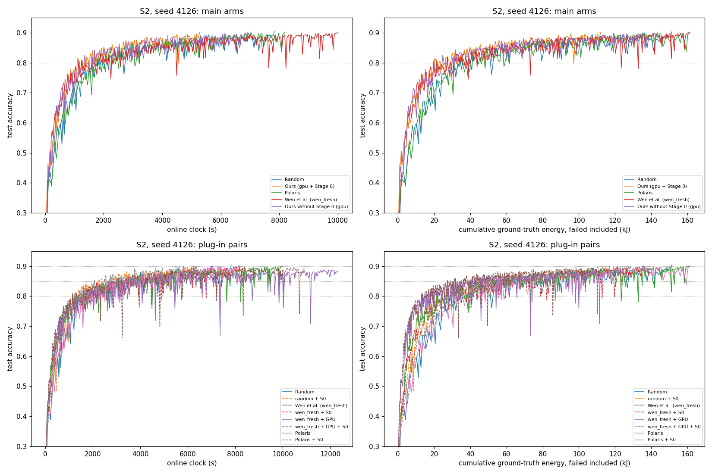

# Scenario 2, seed 4126 — Prompt L report

**Status (23 Oct 2026).**
- `S2_polaris_s4126` reached 90% at round 1,840 and `S2_polaris_s0_s4126` at round 1,930.
- Online = replayed clock in both (max diff 0.0 s).
- Manifests: predictions v3.6 `3fc4fd36`, v3.5 `0f459b68`, source commit `9bd2dc75`.
- All other S2-B arms are existing seed-4126 runs, read through `wen_ptable.run_dir`; `_phaseA/` holds random, gpu and gpu + Stage 0.
- Seeds 4127 / 4128 for the seven seed-4126-only arms were launched on 23 Oct 22:22 UTC on the user's go-ahead. They are reported separately.

**Step 0.**
1. **Energy to X %.** `wen_main_report.py:83` (also `s1_final_report.py:53`, `tools/s1_tta_energy.py:26`, `s2_report.py`) sums E_train + E_up of **every** dispatch with t_finish_clean ≤ TTA. There is no `accepted` filter, so failed dispatches were always included and no value changes. A lost upload is charged its full T_up and E_up (`wen_truth.py`: the upload is lost when the vehicle leaves [400, 1600] at any time during it; there is no partial upload model).
2. **Existing S2 runs at seed 4126.**
   - All 9 exist: random, gpu, gpu + Stage 0, wen, wen_fresh, random_s0, wen_fresh_s0, wen_fresh_gpu, wen_fresh_gpu_s0.
   - Every x_dispatch is inside [400, 1600]. `S2_COVERAGE_M = (400.0, 1600.0)` has not changed since it was committed (`625b1bf4`).
   - The Study 2 runs carry source hash `7caf3811…` (commit `1f81b3c0`). random, gpu, gpu + Stage 0, wen and wen_fresh predate source hashing, so their manifests have no hash.
3. **Environment.** Prompt K was done (23 Oct 18:28 UTC). Free disk was 142 GB, the checkpoint cleaner was running, and the report-only watchdog (30-minute no-merge alert) was active.

**Step 2 (configuration only).**
- `polaris_s0` is the existing Stage 0 plug-in (`STUDY2_ARMS`, gpu estimator) in front of the unchanged Polaris host.
- `polaris` is allowed in S2; `polaris_s0` is S2 only.
- The manifest requires v3.6 for both in S2 and records the v3.6 hash in every S2 manifest.
- A lost upload changes neither G_i nor τ_i: `UploadGate` drops it before the G tracker, and Polaris updates τ through `delivered()`. No code change was needed.

**Step 3 tests: all pass** (full suite: 253 passed).
- `polaris_s0` with Stage 0 off reproduces the `polaris` S2 dispatch log for 100 rounds.
- Stage 0 never receives a non-eligible vehicle, and Polaris never receives a Stage 0-rejected one (unit test on real trace states).
- A lost upload changes neither G nor τ (unit test).
- Σq = 1 over the post-filter pool in every logged call.
- Two 100-round `polaris_s0` runs are identical (dispatch log, `polaris_decisions.csv`, `stage0_log.csv`).
- Online = replayed clock in all six check runs.

**Step 4 smoke (200 rounds, accuracy not read).**

| arm | s/round | share X / O / T | STR | failed dispatches | Stage 0 rejected (reason) | by tier X / O / T | median effective pool (r51–200) | distinct |
|---|---|---|---|---|---|---|---|---|
| polaris | 4.643 | 0.48 / 0.34 / 0.17 | 0.759 | 64 (104 GPU-s, 4.68 kJ) | — | — | 15.9 | 30 |
| polaris_s0 | 3.288 | 0.46 / 0.36 / 0.18 | 0.995 | 1 | 0.244 (all time) | 0.283 / 0.208 / 0.203 | 11.9 | 30 |

**Deviations.**
- **Stage 0 reasons for Ours (gpu + Stage 0).** That run predates per-reason logging, so only its rate (0.240) and per-tier counts are shown, reconstructed from the server log as in `study2_plugin_s4126.md`.
- **Staleness** is computed from the logs as the merge round minus the dispatch round of the same client's k-th dispatch, over merged updates.
- **`source_dirty: true`** in the new manifests comes from the uncommitted `wen_env/study2_report.py`, which is not on the run path.

## 6.1 S2 table, seed 4126

### 6.1a Time, energy, STR, airtime, staleness

| arm | TTA@80 / 85 / 90% (s) | rounds to 80 / 85 / 90% | max accuracy | energy to 80 / 85 / 90% (kJ) | of which wasted (kJ) | **STR** | failed GPU-s | failed kJ | uplink airtime to 80 / 85 / 90% (s) | mean staleness (rounds) |
|---|---|---|---|---|---|---|---|---|---|---|
| Random | 1,813 / 3,002 / 7,833 | 410 / 670 / 1,770 | 0.9040 | 34.6 / 57.9 / 151.5 | 8.78 / 14.99 / 37.48 | **0.769** | 819 | 37.5 | 4,696 / 7,758 / 20,229 | 1.45 |
| Ours (gpu + Stage 0) | 1,109 / 2,003 / 5,279 | 380 / 680 / 1,720 | 0.9011 | 20.3 / 39.7 / 112.1 | 0.22 / 0.34 / 0.86 | **0.992** | 17 | 0.9 | 2,919 / 5,188 / 13,426 | 1.98 |
| Polaris | 1,800 / 2,711 / 8,191 | 400 / 610 / 1,840 | 0.9022 | 34.5 / 51.8 / 161.6 | 8.92 / 13.19 / 40.24 | **0.769** | 889 | 40.2 | 4,638 / 7,001 / 21,051 | 1.46 |
| Wen et al. (wen_fresh) | 1,145 / 3,108 / 10,004 | 340 / 920 / 2,940 | 0.9009 | 19.8 / 52.1 / 160.9 | 0.23 / 1.07 / 5.70 | **0.964** | 105 | 5.7 | 3,011 / 8,241 / 26,789 | 1.91 |
| random + S0 | 1,324 / 2,260 / 6,242 | 400 / 680 / 1,880 | 0.9030 | 25.7 / 44.5 / 121.6 | 0.62 / 1.01 / 2.19 | **0.986** | 50 | 2.2 | 3,420 / 5,819 / 16,122 | 1.96 |
| wen_fresh + S0 | 1,149 / 2,642 / 8,387 | 340 / 790 / 2,540 | 0.9000 | 19.1 / 44.9 / 138.9 | 0.00 / 0.03 / 0.45 | **0.998** | 10 | 0.5 | 3,035 / 6,979 / 22,334 | 1.99 |
| wen_fresh + GPU | 1,327 / 3,205 / — | 410 / 1,000 / — | 0.8876 | 13.1 / 31.7 / — | 1.83 / 4.17 / — | **0.899** | 134 | 13.0 | 3,836 / 9,265 / — | 1.75 |
| wen_fresh + GPU + S0 | 1,256 / 2,644 / — | 460 / 970 / — | 0.8950 | 13.0 / 27.3 / — | 0.10 / 0.22 / — | **0.988** | 15 | 1.4 | 3,612 / 7,624 / — | 1.97 |
| Polaris + S0 | 1,225 / 2,066 / 6,381 | 370 / 620 / 1,930 | 0.9017 | 24.5 / 40.9 / 128.8 | 0.40 / 0.85 / 2.13 | **0.986** | 48 | 2.1 | 3,137 / 5,306 / 16,356 | 1.97 |
| Ours without Stage 0 (gpu) | 1,348 / 2,254 / 6,931 | 420 / 670 / 1,940 | 0.9021 | 24.7 / 45.4 / 143.7 | 2.34 / 5.09 / 19.98 | **0.877** | 444 | 20.1 | 3,551 / 5,800 / 17,708 | 1.70 |

### 6.1b Selection behaviour and Stage 0

| arm | s/round whole / <80% / ≥80% | share X / O / T r1–500 | share X / O / T last 500 | Gini | distinct vehicles | image coverage r500 / r1000 / end | mean \|x_upload − 1000\| (m) | Stage 0 rejected (of eligible) | by reason time / energy / both | by tier X / O / T |
|---|---|---|---|---|---|---|---|---|---|---|
| Random | 4.425 / 4.422 / 4.427 | 0.46 / 0.35 / 0.19 | 0.49 / 0.33 / 0.18 | 0.057 | 30 | 1.000 / 1.000 / 1.000 | 304 | — | — | — |
| Ours (gpu + Stage 0) | 3.069 / 2.917 / 3.112 | 0.34 / 0.37 / 0.28 | 0.48 / 0.33 / 0.19 | 0.116 | 30 | 1.000 / 1.000 / 1.000 | 178 | 0.240 | not logged | counts 3742 / 1919 / 1005 |
| Polaris | 4.451 / 4.499 / 4.438 | 0.48 / 0.35 / 0.18 | 0.53 / 0.31 / 0.16 | 0.050 | 30 | 1.000 / 1.000 / 1.000 | 304 | — | — | — |
| Wen et al. (wen_fresh) | 3.403 / 3.368 / 3.407 | 0.37 / 0.57 / 0.05 | 0.29 / 0.68 / 0.03 | 0.662 | 27 | 0.833 / 0.833 / 0.900 | 310 | — | — | — |
| random + S0 | 3.320 / 3.310 / 3.323 | 0.43 / 0.37 / 0.21 | 0.45 / 0.36 / 0.19 | 0.079 | 30 | 1.000 / 1.000 / 1.000 | 254 | 0.240 | 0.240 / 0.000 / 0.000 | 0.273 / 0.202 / 0.220 |
| wen_fresh + S0 | 3.302 / 3.378 / 3.290 | 0.38 / 0.56 / 0.06 | 0.31 / 0.63 / 0.06 | 0.637 | 28 | 0.867 / 0.867 / 0.933 | 304 | 0.253 | 0.253 / 0.000 / 0.000 | 0.283 / 0.227 / 0.214 |
| wen_fresh + GPU | 3.081 / 3.238 / 3.063 | 0.00 / 0.63 / 0.37 | 0.00 / 0.56 / 0.44 | 0.725 | 15 | 0.433 / 0.433 / 0.500 | 207 | — | — | — |
| wen_fresh + GPU + S0 | 2.731 / 2.731 / 2.731 | 0.01 / 0.64 / 0.35 | 0.00 / 0.56 / 0.43 | 0.680 | 24 | 0.533 / 0.633 / 0.800 | 181 | 0.243 | 0.243 / 0.000 / 0.000 | 0.261 / 0.212 / 0.240 |
| Polaris + S0 | 3.306 / 3.312 / 3.305 | 0.46 / 0.34 / 0.20 | 0.50 / 0.33 / 0.17 | 0.073 | 30 | 1.000 / 1.000 / 1.000 | 246 | 0.242 | 0.242 / 0.000 / 0.000 | 0.277 / 0.202 / 0.220 |
| Ours without Stage 0 (gpu) | 3.573 / 3.211 / 3.673 | 0.34 / 0.42 / 0.24 | 0.48 / 0.31 / 0.20 | 0.122 | 30 | 1.000 / 1.000 / 1.000 | 213 | — | — | — |

## 6.2 Pairwise directions, Ours vs each arm (seed 4126, sign only)

`<` = Ours lower (faster / less energy); STR `>` = Ours higher. A threshold Ours reaches and the other does not counts as Ours lower.

| Ours vs | TTA 80 / 85 / 90% | energy 80 / 85 / 90% | STR |
|---|---|---|---|
| Random | < / < / < | < / < / < | > (0.992 vs 0.769) |
| Polaris | < / < / < | < / < / < | > (0.992 vs 0.769) |
| Wen et al. (wen_fresh) | < / < / < | > / < / < | > (0.992 vs 0.964) |
| random + S0 | < / < / < | < / < / < | > (0.992 vs 0.986) |
| wen_fresh + S0 | < / < / < | > / < / < | < (0.992 vs 0.998) |
| wen_fresh + GPU | < / < / < | > / > / < | > (0.992 vs 0.899) |
| wen_fresh + GPU + S0 | < / < / < | > / > / < | > (0.992 vs 0.988) |
| Polaris + S0 | < / < / < | < / < / < | > (0.992 vs 0.986) |
| Ours without Stage 0 (gpu) | < / < / < | < / < / < | > (0.992 vs 0.877) |

## 6.3 Plug-in pairs (B − A; `x → y` where one side did not reach)

| A → B | ΔTTA 80 / 85 / 90% (s) | Δrounds 80 / 85 / 90% | Δmax acc | Δenergy 80 / 85 / 90% (kJ) | ΔSTR | Δfailed GPU-s | Δfailed kJ | Δairtime 80 / 85 / 90% (s) | Δstaleness | Δs/round | ΔGini | Δdistinct | Δ\|x_upload − 1000\| (m) |
|---|---|---|---|---|---|---|---|---|---|---|---|---|---|
| Random → random + S0 | -489 / -742 / -1591 | -10 / +10 / +110 | -0.0010 | -8.9 / -13.4 / -29.8 | +0.218 | -769 | -35.3 | -1276 / -1939 / -4107 | +0.51 | -1.105 | +0.023 | +0 | -50 |
| Wen et al. (wen_fresh) → wen_fresh + S0 | +4 / -467 / -1617 | +0 / -130 / -400 | -0.0009 | -0.7 / -7.2 / -22.0 | +0.033 | -95 | -5.3 | +23 / -1262 / -4455 | +0.08 | -0.101 | -0.025 | +1 | -6 |
| wen_fresh + GPU → wen_fresh + GPU + S0 | -71 / -561 / n/r | +50 / -30 / n/r | +0.0074 | -0.1 / -4.4 / n/r | +0.090 | -119 | -11.6 | -223 / -1640 / n/r | +0.21 | -0.351 | -0.045 | +9 | -26 |
| Polaris → Polaris + S0 | -574 / -645 / -1809 | -30 / +10 / +90 | -0.0005 | -10.1 / -10.9 / -32.9 | +0.217 | -841 | -38.1 | -1502 / -1695 / -4696 | +0.50 | -1.145 | +0.023 | +0 | -58 |
| Wen et al. (wen_fresh) → wen_fresh + GPU | +182 / +97 / 10004 → — | +70 / +80 / 2940 → — | -0.0133 | -6.7 / -20.5 / 160.9 → — | -0.066 | +28 | +7.3 | +824 / +1024 / 26789 → — | -0.16 | -0.321 | +0.063 | -12 | -103 |

## 6.4 P-table (seed 4126)

| P | prediction (waste lower evaluated as STR higher, v3.6) | seed 4126 | direction | status |
|---|---|---|---|---|
| P25 | gpu (Stage 0 off) has lower TTA@80% than wen_fresh | 1,348 vs 1,145 | not as predicted | single seed — not evaluated |
| P26 | random + Stage 0 has a lower waste fraction than random (STR higher) | 0.986 vs 0.769 | as predicted | single seed — not evaluated |
| P27 | random + Stage 0 has a lower TTA@80% than random | 1,324 vs 1,813 | as predicted | single seed — not evaluated |
| P28 | wen_fresh + Stage 0 has a lower waste fraction than wen_fresh (STR higher) | 0.998 vs 0.964 | as predicted | single seed — not evaluated |
| P33 | wen_fresh + GPU + Stage 0 waste fraction no higher than wen_fresh + GPU (STR no lower) | 0.988 vs 0.899 | as predicted | single seed — not evaluated |
| P38 | Ours has lower TTA@80% than Polaris | 1,109 vs 1,800 | as predicted | single seed — not evaluated |
| P39 | Ours has a higher STR than Polaris | 0.992 vs 0.769 | as predicted | single seed — not evaluated |
| P40 | Ours uses less energy to reach 80% than Polaris (failed included) | 20.3 kJ vs 34.5 kJ | as predicted | single seed — not evaluated |
| P41 | Ours has lower TTA@80% than wen_fresh | 1,109 vs 1,145 | as predicted | single seed — not evaluated |
| P42 | Polaris + Stage 0 has a higher STR than Polaris | 0.986 vs 0.769 | as predicted | single seed — not evaluated |
| P43 | Polaris + Stage 0 has lower TTA@80% than Polaris | 1,225 vs 1,800 | as predicted | single seed — not evaluated |

## 6.5 Curves

