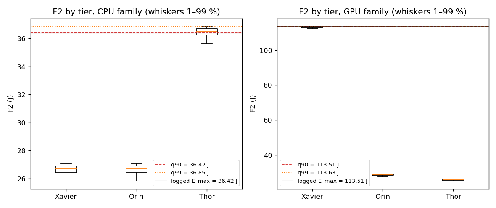

# Why Wen et al. excludes Thor — static replay on logged candidates (Prompt N Part 1)

v3.8 lock commit `6feeb8e7`; code at `6feeb8e7`; script `wen_env/wen_thor_replay.py`.

Static replay: same candidate sets, decision order and logged F3 / F4 as the S1 `wen_fresh` runs; only the replay's F1 / F2 model, limits or objectives change. It ignores feedback: in a real run the model trajectory, and so F3, would differ. Candidate sets are the logged ones also within a round, so a slot-2 / slot-3 set excludes the logged (not the replayed) earlier pick.

## Step 0 — inventory of `wen_candidates.csv`

| run | decisions | rows / decision | n_feasible / decision | infeasible rows | of which with raw F1–F4 |
|---|---|---|---|---|---|
| S1_wen_fresh_s4126 | 4,002 | 28.00 | 22.09 | 23,669 | 23,669 |
| S1_wen_fresh_s4127 | 4,002 | 28.00 | 22.07 | 23,717 | 23,717 |
| S1_wen_fresh_s4128 | 4,002 | 28.00 | 22.06 | 23,765 | 23,765 |
| S1_wen_fresh_gpu_s4126 | 4,002 | 28.00 | 25.03 | 11,906 | 11,906 |
| S1_wen_fresh_gpu_s4127 | 4,002 | 28.00 | 25.02 | 11,927 | 11,927 |
| S1_wen_fresh_gpu_s4128 | 4,002 | 28.00 | 24.98 | 12,071 | 12,071 |

Columns: `round, t, decision, client_id, tier, x, F1, F2, F3, F4, feasible, pareto, picked, global_version`.

Requested columns: `x` yes; `t` yes; `tier` yes; `feasible` yes; `pareto` yes; `picked` yes; `x_dispatch` no; `V_k` no; `feasible_T` no; `feasible_E` no.
Candidate position is logged as `x` (the reported position at decision time `t`), so no SUMO reconstruction is needed. `V_k` is not logged; it is the constant reported speed from `fleet_speeds.csv`. `feasible_T` / `feasible_E` are not logged in these runs; they are recomputed from F1, F2 and the limits.

## Gates

- G3 PASS: recomputed CPU F1 / F2 equal every logged `wen_fresh` value and GPU F1 / F2 every logged `wen_fresh_gpu` value (1e-9 rel.), 336,177 + GPU rows.
- GX3 PASS: recomputed GPU/GPU q90 limits equal the `wen_fresh_gpu` manifest (13.564085609369194 s, 113.50862433236982 J); CPU/CPU q90 equal the `wen_fresh` config.
- G4 PASS: R0 reproduces every logged pick and feasible set of the three `wen_fresh` runs (12,006 decisions).

## Limits per replay (W5 rule over 30 vehicles × trace samples, 900,000 pairs)

| replay | F1 model | F2 model | T_max rule | T_max (s) | E_max rule | E_max (J) | objectives |
|---|---|---|---|---|---|---|---|
| R0 | CPU | CPU | q90 | 34.334345905647005 | q90 | 36.423846640394224 | F1–F4 |
| R1 | CPU | CPU | q90 | 34.334345905647005 | q99 | 36.8489761368458 | F1–F4 |
| R2 | CPU | CPU | q90 | 34.334345905647005 | inf | inf | F1–F4 |
| R3 | CPU | CPU | inf | inf | inf | inf | F1–F4 |
| R4 | CPU | CPU | inf | inf | inf | inf | F1 + F2 |
| X1 | CPU | GPU | q90 | 34.334345905647005 | q90 | 113.50862433236982 | F1–F4 |
| X2 | GPU | CPU | q90 | 13.564085609369194 | q90 | 36.423846640394224 | F1–F4 |
| X3 | GPU | GPU | q90 | 13.564085609369194 | q90 | 113.50862433236982 | F1–F4 |
| X1inf | CPU | GPU | inf | inf | inf | inf | F1–F4 |
| X2inf | GPU | CPU | inf | inf | inf | inf | F1–F4 |

## 1. Per-tier rates and 2. concentration

Rates are shares of that tier's candidate rows (feasible / in the Pareto set / picked); "share" is the tier's share of all replayed picks. Random = the realised whole-run tier share of `S1_random_s<seed>`.

| replay | seed | X feas | O feas | T feas | X Pareto | O Pareto | T Pareto | X picked | O picked | T picked | X share | O share | **T share** | Gini | distinct | fallback |
|---|---|---|---|---|---|---|---|---|---|---|---|---|---|---|---|---|
| R0 | 4126 | 0.88 | 0.87 | 0.40 | 0.20 | 0.31 | 0.32 | 0.014 | 0.094 | 0.001 | 0.199 | 0.798 | **0.002** | 0.819 | 24 | 0 |
| R0 | 4127 | 0.87 | 0.87 | 0.41 | 0.18 | 0.32 | 0.37 | 0.018 | 0.087 | 0.000 | 0.252 | 0.748 | **0.000** | 0.796 | 24 | 0 |
| R0 | 4128 | 0.87 | 0.87 | 0.40 | 0.21 | 0.29 | 0.35 | 0.036 | 0.055 | 0.000 | 0.499 | 0.501 | **0.000** | 0.792 | 24 | 0 |
| R1 | 4126 | 0.88 | 0.87 | 0.94 | 0.20 | 0.31 | 0.50 | 0.012 | 0.097 | 0.001 | 0.177 | 0.819 | **0.003** | 0.843 | 22 | 0 |
| R1 | 4127 | 0.87 | 0.87 | 0.94 | 0.18 | 0.32 | 0.62 | 0.018 | 0.086 | 0.000 | 0.262 | 0.738 | **0.000** | 0.800 | 22 | 0 |
| R1 | 4128 | 0.87 | 0.87 | 0.94 | 0.21 | 0.29 | 0.67 | 0.036 | 0.055 | 0.000 | 0.499 | 0.501 | **0.001** | 0.808 | 21 | 0 |
| R2 | 4126 | 0.88 | 0.87 | 1.00 | 0.20 | 0.31 | 0.50 | 0.012 | 0.097 | 0.001 | 0.177 | 0.820 | **0.003** | 0.843 | 22 | 0 |
| R2 | 4127 | 0.87 | 0.87 | 1.00 | 0.18 | 0.32 | 0.64 | 0.018 | 0.086 | 0.000 | 0.263 | 0.737 | **0.000** | 0.799 | 22 | 0 |
| R2 | 4128 | 0.87 | 0.87 | 1.00 | 0.21 | 0.29 | 0.70 | 0.036 | 0.055 | 0.000 | 0.499 | 0.501 | **0.001** | 0.808 | 20 | 0 |
| R3 | 4126 | 1.00 | 1.00 | 1.00 | 0.21 | 0.34 | 0.50 | 0.011 | 0.098 | 0.000 | 0.165 | 0.834 | **0.001** | 0.852 | 20 | 0 |
| R3 | 4127 | 1.00 | 1.00 | 1.00 | 0.19 | 0.35 | 0.64 | 0.016 | 0.089 | 0.000 | 0.233 | 0.767 | **0.000** | 0.814 | 21 | 0 |
| R3 | 4128 | 1.00 | 1.00 | 1.00 | 0.22 | 0.31 | 0.70 | 0.034 | 0.057 | 0.000 | 0.480 | 0.519 | **0.001** | 0.815 | 20 | 0 |
| R4 | 4126 | 1.00 | 1.00 | 1.00 | 0.05 | 0.04 | 0.19 | 0.046 | 0.039 | 0.000 | 0.666 | 0.334 | **0.000** | 0.290 | 25 | 0 |
| R4 | 4127 | 1.00 | 1.00 | 1.00 | 0.04 | 0.04 | 0.19 | 0.044 | 0.042 | 0.000 | 0.638 | 0.362 | **0.000** | 0.294 | 25 | 0 |
| R4 | 4128 | 1.00 | 1.00 | 1.00 | 0.04 | 0.04 | 0.19 | 0.044 | 0.043 | 0.000 | 0.609 | 0.391 | **0.000** | 0.303 | 25 | 0 |
| X1 | 4126 | 0.67 | 0.87 | 1.00 | 0.12 | 0.40 | 0.77 | 0.000 | 0.070 | 0.082 | 0.000 | 0.589 | **0.410** | 0.870 | 13 | 0 |
| X1 | 4127 | 0.67 | 0.87 | 1.00 | 0.15 | 0.52 | 0.92 | 0.000 | 0.096 | 0.034 | 0.000 | 0.828 | **0.171** | 0.827 | 14 | 0 |
| X1 | 4128 | 0.66 | 0.87 | 1.00 | 0.13 | 0.38 | 0.87 | 0.000 | 0.041 | 0.126 | 0.000 | 0.370 | **0.629** | 0.880 | 12 | 0 |
| X2 | 4126 | 0.80 | 1.00 | 0.40 | 0.27 | 0.61 | 0.06 | 0.005 | 0.110 | 0.000 | 0.070 | 0.930 | **0.000** | 0.848 | 16 | 0 |
| X2 | 4127 | 0.79 | 1.00 | 0.41 | 0.24 | 0.63 | 0.04 | 0.004 | 0.109 | 0.000 | 0.059 | 0.941 | **0.000** | 0.855 | 15 | 0 |
| X2 | 4128 | 0.79 | 1.00 | 0.40 | 0.28 | 0.63 | 0.17 | 0.016 | 0.085 | 0.000 | 0.225 | 0.775 | **0.000** | 0.854 | 18 | 0 |
| X3 | 4126 | 0.80 | 1.00 | 1.00 | 0.04 | 0.36 | 0.57 | 0.000 | 0.098 | 0.034 | 0.000 | 0.831 | **0.169** | 0.828 | 13 | 0 |
| X3 | 4127 | 0.79 | 1.00 | 1.00 | 0.04 | 0.36 | 0.84 | 0.000 | 0.097 | 0.033 | 0.000 | 0.834 | **0.166** | 0.793 | 14 | 0 |
| X3 | 4128 | 0.79 | 1.00 | 1.00 | 0.07 | 0.35 | 0.77 | 0.000 | 0.076 | 0.061 | 0.001 | 0.694 | **0.305** | 0.847 | 16 | 0 |
| X1inf | 4126 | 1.00 | 1.00 | 1.00 | 0.14 | 0.45 | 0.77 | 0.000 | 0.078 | 0.067 | 0.000 | 0.663 | **0.337** | 0.862 | 13 | 0 |
| X1inf | 4127 | 1.00 | 1.00 | 1.00 | 0.19 | 0.57 | 0.92 | 0.000 | 0.103 | 0.023 | 0.000 | 0.887 | **0.113** | 0.853 | 13 | 0 |
| X1inf | 4128 | 1.00 | 1.00 | 1.00 | 0.18 | 0.41 | 0.87 | 0.000 | 0.049 | 0.110 | 0.000 | 0.449 | **0.551** | 0.878 | 12 | 0 |
| X2inf | 4126 | 1.00 | 1.00 | 1.00 | 0.31 | 0.61 | 0.21 | 0.004 | 0.112 | 0.000 | 0.051 | 0.949 | **0.000** | 0.859 | 15 | 0 |
| X2inf | 4127 | 1.00 | 1.00 | 1.00 | 0.27 | 0.63 | 0.18 | 0.003 | 0.111 | 0.000 | 0.045 | 0.955 | **0.000** | 0.868 | 18 | 0 |
| X2inf | 4128 | 1.00 | 1.00 | 1.00 | 0.32 | 0.63 | 0.48 | 0.014 | 0.088 | 0.000 | 0.198 | 0.802 | **0.000** | 0.866 | 18 | 0 |
| Random (realised) | 4126 | | | | | | | | | | 0.467 | 0.358 | **0.174** | | | |
| Random (realised) | 4127 | | | | | | | | | | 0.511 | 0.331 | **0.158** | | | |
| Random (realised) | 4128 | | | | | | | | | | 0.490 | 0.345 | **0.166** | | | |

## 3. Thor diagnostics

Over decisions with ≥ 1 Thor in the Pareto set. "best" = lowest Wen score within the group. Inequality (P51 form): nF2(best Thor) − nF2(best other) > nF1(best other) − nF1(best Thor). F1 range of the Pareto set vs tier gap = min F1(other) − min F1(Thor) and within-other spread = max − min F1 among the others (means, seconds).

| replay | seed | decisions | Thor picked | best Thor nF1–nF4 | best other nF1–nF4 | inequality share | Pareto F1 range | tier gap | within-other spread |
|---|---|---|---|---|---|---|---|---|---|
| R0 | 4126 | 3,664 | 0.003 | 0.06 / 0.99 / 0.79 / 0.52 | 0.83 / 0.05 / 0.03 / 0.07 | 0.599 | 6.26 | 2.51 | 3.75 |
| R0 | 4127 | 3,683 | 0.000 | 0.03 / 0.98 / 0.82 / 0.69 | 0.80 / 0.05 / 0.05 / 0.09 | 0.557 | 6.16 | 2.49 | 3.66 |
| R0 | 4128 | 3,688 | 0.001 | 0.06 / 0.99 / 0.79 / 0.26 | 0.77 / 0.04 / 0.04 / 0.14 | 0.719 | 6.36 | 2.50 | 3.86 |
| R1 | 4126 | 3,968 | 0.003 | 0.22 / 0.99 / 0.67 / 0.33 | 0.82 / 0.05 / 0.03 / 0.07 | 0.780 | 6.11 | 2.32 | 3.75 |
| R1 | 4127 | 3,959 | 0.000 | 0.05 / 0.96 / 0.78 / 0.58 | 0.77 / 0.04 / 0.06 / 0.09 | 0.595 | 6.01 | 2.33 | 3.65 |
| R1 | 4128 | 3,999 | 0.001 | 0.13 / 0.96 / 0.79 / 0.16 | 0.74 / 0.04 / 0.04 / 0.20 | 0.754 | 6.18 | 2.31 | 3.83 |
| R2 | 4126 | 3,971 | 0.003 | 0.23 / 0.99 / 0.67 / 0.32 | 0.81 / 0.05 / 0.03 / 0.07 | 0.791 | 6.10 | 2.32 | 3.75 |
| R2 | 4127 | 3,960 | 0.000 | 0.05 / 0.96 / 0.78 / 0.58 | 0.77 / 0.04 / 0.06 / 0.09 | 0.594 | 6.01 | 2.33 | 3.65 |
| R2 | 4128 | 4,002 | 0.001 | 0.13 / 0.96 / 0.79 / 0.17 | 0.74 / 0.04 / 0.04 / 0.21 | 0.752 | 6.18 | 2.30 | 3.83 |
| R3 | 4126 | 3,971 | 0.001 | 0.22 / 0.99 / 0.67 / 0.34 | 0.77 / 0.05 / 0.03 / 0.08 | 0.836 | 6.53 | 2.32 | 4.18 |
| R3 | 4127 | 3,960 | 0.000 | 0.05 / 0.96 / 0.78 / 0.59 | 0.75 / 0.04 / 0.05 / 0.10 | 0.627 | 6.33 | 2.33 | 3.97 |
| R3 | 4128 | 4,002 | 0.001 | 0.13 / 0.96 / 0.79 / 0.15 | 0.71 / 0.04 / 0.04 / 0.20 | 0.786 | 6.51 | 2.30 | 4.16 |
| R4 | 4126 | 3,810 | 0.000 | 0.00 / 1.00 / — / — | 1.00 / 0.00 / — / — | 0.008 | 2.45 | 2.45 | 0.00 |
| R4 | 4127 | 3,790 | 0.000 | 0.00 / 1.00 / — / — | 1.00 / 0.00 / — / — | 0.008 | 2.46 | 2.46 | 0.00 |
| R4 | 4128 | 3,801 | 0.000 | 0.00 / 1.00 / — / — | 1.00 / 0.00 / — / — | 0.014 | 2.46 | 2.46 | 0.00 |
| X2 | 4126 | 983 | 0.000 | 0.21 / 1.00 / 0.68 / 0.33 | 0.43 / 0.07 / 0.04 / 0.07 | 0.995 | 5.45 | -0.90 | 5.24 |
| X2 | 4127 | 716 | 0.000 | 0.19 / 1.00 / 0.58 / 0.83 | 0.42 / 0.07 / 0.06 / 0.05 | 0.990 | 5.36 | -0.77 | 5.11 |
| X2 | 4128 | 2,567 | 0.000 | 0.38 / 1.00 / 0.78 / 0.09 | 0.36 / 0.07 / 0.04 / 0.12 | 0.998 | 5.71 | -2.02 | 5.63 |
| X2inf | 4126 | 2,564 | 0.000 | 0.14 / 0.99 / 0.71 / 0.38 | 0.39 / 0.07 / 0.03 / 0.07 | 0.992 | 6.43 | 0.18 | 5.74 |
| X2inf | 4127 | 2,255 | 0.000 | 0.09 / 1.00 / 0.71 / 0.69 | 0.41 / 0.07 / 0.04 / 0.04 | 0.984 | 6.42 | 0.31 | 5.64 |
| X2inf | 4128 | 4,002 | 0.000 | 0.28 / 0.98 / 0.77 / 0.11 | 0.34 / 0.07 / 0.03 / 0.15 | 0.995 | 6.58 | -0.83 | 6.15 |

## 4. Xavier diagnostics

Over decisions with ≥ 1 Xavier in the Pareto set. "best" = lowest Wen score within the group. Inequality (P51 form): nF2(best Xavier) − nF2(best other) > nF1(best other) − nF1(best Xavier). F1 range of the Pareto set vs tier gap = min F1(other) − min F1(Xavier) and within-other spread = max − min F1 among the others (means, seconds).

| replay | seed | decisions | Xavier picked | best Xavier nF1–nF4 | best other nF1–nF4 | inequality share | Pareto F1 range | tier gap | within-other spread |
|---|---|---|---|---|---|---|---|---|---|
| X1 | 4126 | 3,160 | 0.001 | 0.58 / 1.00 / 0.35 / 0.45 | 0.59 / 0.03 / 0.17 / 0.08 | 0.997 | 6.64 | -3.08 | 6.54 |
| X1 | 4127 | 3,439 | 0.000 | 0.56 / 1.00 / 0.27 / 0.30 | 0.71 / 0.03 / 0.09 / 0.07 | 0.997 | 6.76 | -3.04 | 6.70 |
| X1 | 4128 | 3,416 | 0.000 | 0.68 / 1.00 / 0.14 / 0.35 | 0.39 / 0.02 / 0.46 / 0.11 | 0.999 | 6.74 | -3.72 | 6.47 |
| X1inf | 4126 | 3,349 | 0.000 | 0.64 / 1.00 / 0.27 / 0.37 | 0.59 / 0.03 / 0.14 / 0.09 | 0.998 | 7.03 | -3.23 | 6.92 |
| X1inf | 4127 | 3,529 | 0.000 | 0.56 / 1.00 / 0.25 / 0.30 | 0.74 / 0.03 / 0.05 / 0.06 | 0.997 | 7.05 | -3.06 | 7.01 |
| X1inf | 4128 | 3,641 | 0.000 | 0.67 / 1.00 / 0.11 / 0.31 | 0.42 / 0.02 / 0.41 / 0.11 | 0.999 | 7.08 | -3.75 | 6.84 |

## 5. Client 26 (Thor)

- seed 4126: F4 = 0.2553, F4 rank 6 of 30 (1 = lowest KL).
- seed 4127: F4 = 0.7347, F4 rank 30 of 30 (1 = lowest KL).
- seed 4128: F4 = 0.1980, F4 rank 1 of 30 (1 = lowest KL).

| replay | seed | candidate rows | feasible | in Pareto | picked | mean nF1–nF4 when in Pareto |
|---|---|---|---|---|---|---|
| R0 | 4126 | 3,982 | 1,611 | 1,602 | 10 | 0.12 / 1.00 / 0.67 / 0.25 |
| R0 | 4127 | 4,002 | 1,609 | 1,542 | 0 | 0.12 / 0.99 / 0.54 / 1.00 |
| R0 | 4128 | 3,998 | 1,586 | 1,586 | 2 | 0.11 / 0.99 / 0.86 / 0.00 |
| R1 | 4126 | 3,982 | 3,766 | 3,481 | 13 | 0.30 / 1.00 / 0.64 / 0.23 |
| R1 | 4127 | 4,002 | 3,750 | 2,906 | 0 | 0.26 / 0.98 / 0.49 / 1.00 |
| R1 | 4128 | 3,998 | 3,741 | 3,741 | 2 | 0.31 / 0.98 / 0.84 / 0.00 |
| R2 | 4126 | 3,982 | 3,982 | 3,643 | 13 | 0.31 / 1.00 / 0.63 / 0.23 |
| R2 | 4127 | 4,002 | 4,002 | 2,995 | 0 | 0.28 / 0.98 / 0.49 / 1.00 |
| R2 | 4128 | 3,998 | 3,998 | 3,998 | 2 | 0.34 / 0.98 / 0.84 / 0.00 |
| R3 | 4126 | 3,982 | 3,982 | 3,643 | 5 | 0.29 / 1.00 / 0.64 / 0.26 |
| R3 | 4127 | 4,002 | 4,002 | 2,995 | 0 | 0.26 / 0.98 / 0.50 / 1.00 |
| R3 | 4128 | 3,998 | 3,998 | 3,998 | 2 | 0.32 / 0.98 / 0.84 / 0.00 |
| R4 | 4126 | 3,982 | 3,982 | 728 | 0 | 0.00 / 1.00 / — / — |
| R4 | 4127 | 4,002 | 4,002 | 749 | 0 | 0.00 / 1.00 / — / — |
| R4 | 4128 | 3,998 | 3,998 | 760 | 0 | 0.00 / 1.00 / — / — |
| X1 | 4126 | 3,982 | 3,982 | 3,982 | 1,579 | 0.31 / 0.03 / 0.61 / 0.21 |
| X1 | 4127 | 4,002 | 4,002 | 3,888 | 65 | 0.29 / 0.02 / 0.49 / 1.00 |
| X1 | 4128 | 3,998 | 3,998 | 3,998 | 1,726 | 0.30 / 0.02 / 0.84 / 0.00 |
| X2 | 4126 | 3,982 | 1,611 | 600 | 0 | 0.20 / 1.00 / 0.60 / 0.19 |
| X2 | 4127 | 4,002 | 1,609 | 427 | 0 | 0.18 / 1.00 / 0.46 / 1.00 |
| X2 | 4128 | 3,998 | 1,586 | 1,586 | 0 | 0.39 / 1.00 / 0.82 / 0.00 |
| X3 | 4126 | 3,982 | 3,982 | 3,982 | 515 | 0.68 / 0.07 / 0.67 / 0.31 |
| X3 | 4127 | 4,002 | 4,002 | 3,802 | 82 | 0.63 / 0.08 / 0.50 / 1.00 |
| X3 | 4128 | 3,998 | 3,998 | 3,998 | 675 | 0.60 / 0.05 / 0.90 / 0.00 |
| X1inf | 4126 | 3,982 | 3,982 | 3,982 | 1,296 | 0.29 / 0.02 / 0.61 / 0.23 |
| X1inf | 4127 | 4,002 | 4,002 | 3,888 | 52 | 0.28 / 0.02 / 0.50 / 1.00 |
| X1inf | 4128 | 3,998 | 3,998 | 3,998 | 1,573 | 0.28 / 0.02 / 0.84 / 0.00 |
| X2inf | 4126 | 3,982 | 3,982 | 1,302 | 0 | 0.24 / 0.99 / 0.58 / 0.19 |
| X2inf | 4127 | 4,002 | 4,002 | 1,011 | 0 | 0.21 / 0.99 / 0.43 / 1.00 |
| X2inf | 4128 | 3,998 | 3,998 | 3,998 | 0 | 0.44 / 0.98 / 0.80 / 0.00 |

## 6. F2 by tier

| family | tier | F2 min | F2 median | F2 max | share > q90 | share > q99 |
|---|---|---|---|---|---|---|
| CPU | Xavier | 25.792 | 26.707 | 27.076 | 0.0% | 0.0% |
| CPU | Orin | 25.777 | 26.700 | 27.076 | 0.0% | 0.0% |
| CPU | Thor | 35.603 | 36.519 | 36.888 | 60.0% | 6.0% |
| GPU | Xavier | 112.359 | 113.273 | 113.643 | 20.0% | 2.0% |
| GPU | Orin | 27.757 | 28.680 | 29.058 | 0.0% | 0.0% |
| GPU | Thor | 25.118 | 26.033 | 26.402 | 0.0% | 0.0% |

## P49–P53 (v3 rule: same direction in all three seeds)

| id | prediction | seed 4126 | seed 4127 | seed 4128 | v3 verdict |
|---|---|---|---|---|---|
| P49 | R1: Thor share of picks < 0.05 | 0.003 (yes) | 0.000 (yes) | 0.001 (yes) | supported (3 / 3 seeds) |
| P50 | R2: Thor share < Random's realised Thor share | 0.003 (yes) | 0.000 (yes) | 0.001 (yes) | supported (3 / 3 seeds) |
| P51 | R2: inequality holds in > 1/2 of decisions with Thor in Pareto | 0.791 (yes) | 0.594 (yes) | 0.752 (yes) | supported (3 / 3 seeds) |
| P52 | X1: Xavier share of picks < 0.05 | 0.000 (yes) | 0.000 (yes) | 0.000 (yes) | supported (3 / 3 seeds) |
| P53 | X2: Thor share of picks < 0.05 | 0.000 (yes) | 0.000 (yes) | 0.000 (yes) | supported (3 / 3 seeds) |

## Decision rule for Part 2 `wen_fresh_q99`

R1 Thor share: seed 4126 0.003, seed 4127 0.000, seed 4128 0.001. No seed ≥ 0.05 → **skip `wen_fresh_q99`**.

## Layer check (mechanical)

- Layer 2 (our E_max calibration) as the sole cause: Thor share rises to ≥ Random's under R2 in every seed → not consistent.
- Layer 1 + 3 (Wen's CPU energy model and normalisation) excluding Thor without constraints: R3 Thor share < Random's in every seed → consistent.
- Layer 3 alone (R4, F1 + F2, no limits): Thor share < Random's in every seed → consistent.
- Energy model removes the tier it prices highest (P52 and P53 both hold in every seed) → consistent.

Wall time 80 s.

